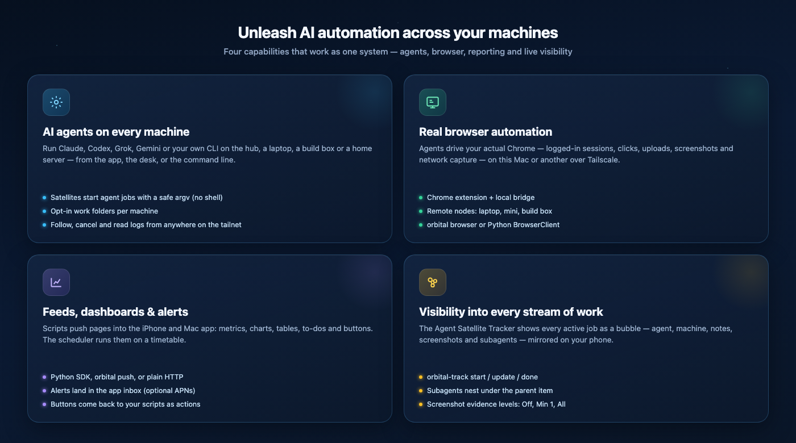
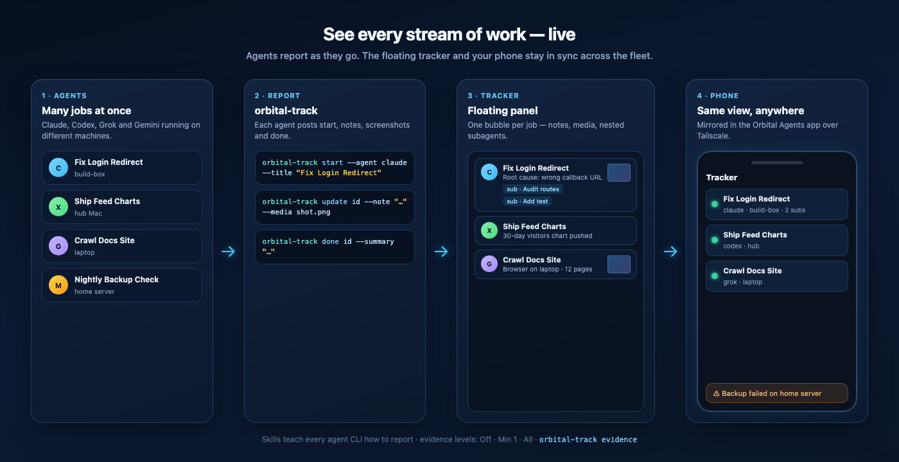
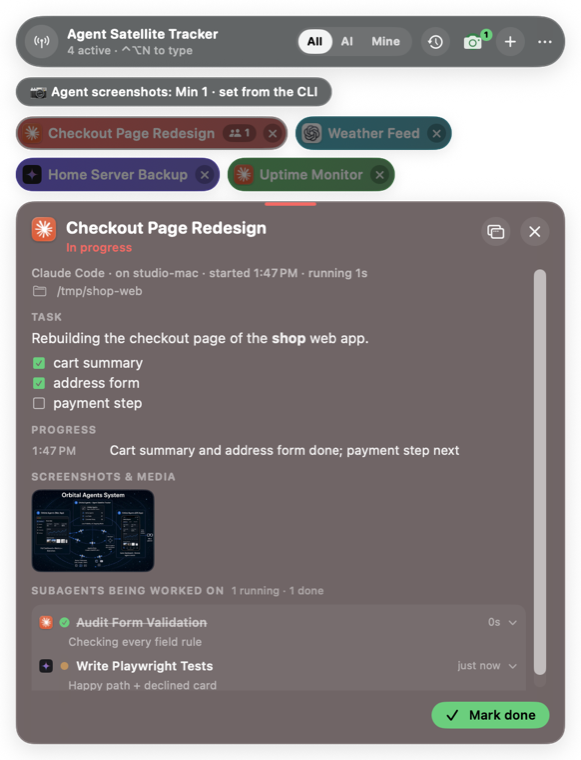
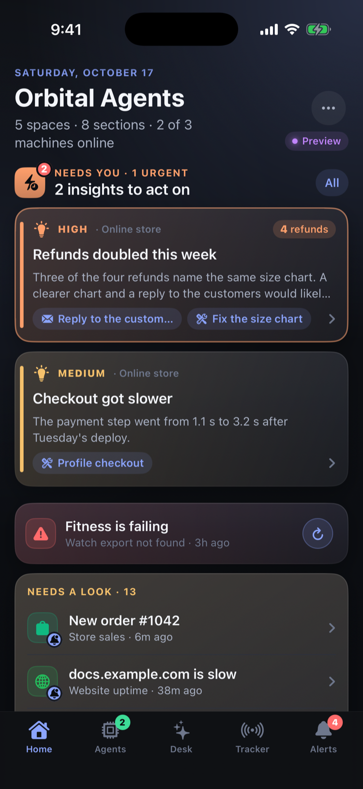
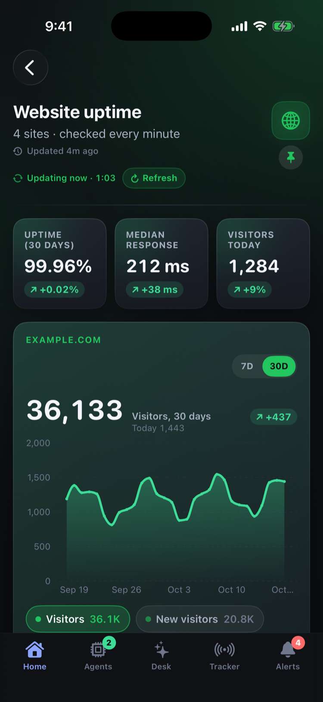
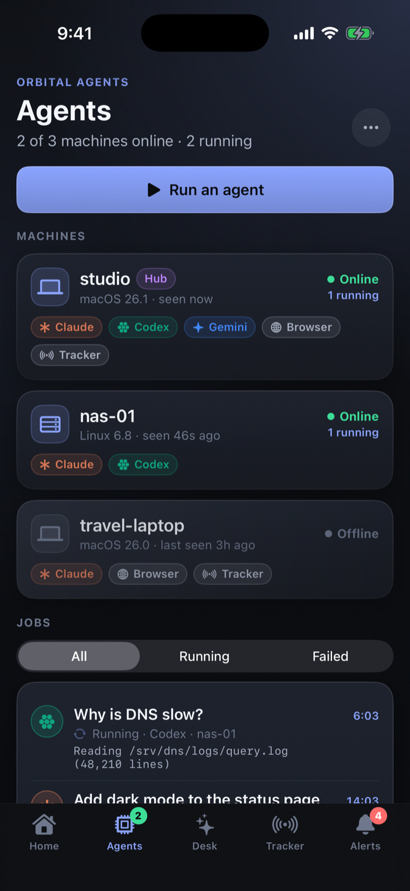
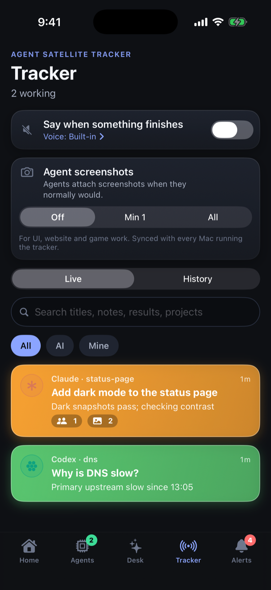
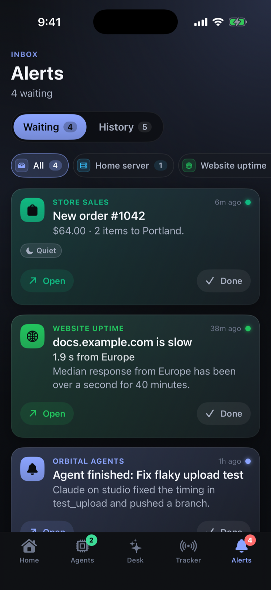
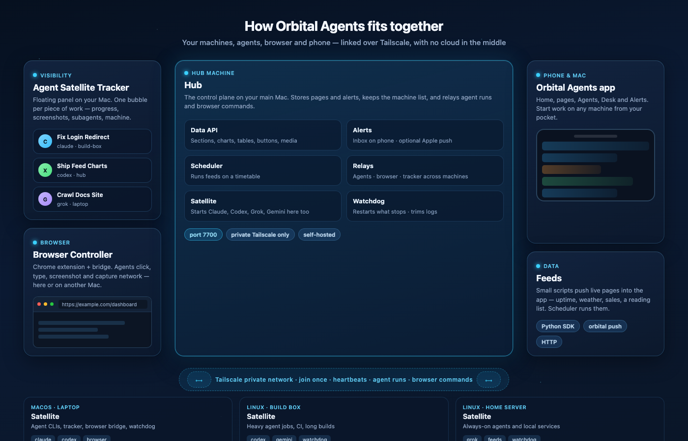

<p align="center">
  
</p>

# Orbital Agents

[](https://github.com/joecodecreations/orbital-agents/actions/workflows/ci.yml)
[](LICENSE)

Run, watch and steer AI agents (Claude, Codex, Grok, Gemini, or your own command-line tools) across all your machines. A floating tracker on your Mac shows what every agent is working on right now. An iPhone and Mac app shows your dashboards, alerts, machines and agent jobs, and starts new work on any machine. Agents can drive a real Chrome browser, here or on another machine. Everything runs on your own computers and talks over your private Tailscale network; there is no cloud service in the middle.

<p align="center">
  
</p>

## What you get

| Piece | What it does |
|---|---|
| **Hub** | A small server on your main machine. It stores the pages your scripts push, raises alerts, keeps the list of machines, and relays agent runs and browser commands to them. |
| **Satellites** | Every machine (the hub too) runs a satellite service that starts agent CLIs when asked, so "run Claude on the build box" works from anywhere. |
| **Agent Satellite Tracker** | A floating, see-through panel on your Mac: one bubble per piece of work, with the agent's icon, progress notes, screenshots, subagents and the machine it runs on. Agents report to it with `orbital-track`. |
| **Orbital Agents app** | iPhone, iPad and Mac. Home shows what needs you; pages show your data; Agents lists every machine and its jobs; Desk lets you talk to an agent; Alerts is the inbox. |
| **Browser Controller** | A Chrome extension and a local bridge, so agents can open pages, click, type, read, upload and take screenshots in your real browser, on this machine or another one over Tailscale. |
| **Feeds and scheduler** | Small scripts that read anything (a server, a website, an API) and push it to the app as pages, charts, tables, to-do lists and buttons. The scheduler runs them on a timetable. |
| **Self-healing** | Login services that restart on crash, a watchdog that restarts what stops answering and tells your phone, and a janitor that keeps logs and data from growing without limit. |
| **Agent skills** | Instructions installed into Claude Code, Codex, Grok and Gemini, so your agents know how to report work, push data, use other machines and drive the browser. |

<p align="center">
  
</p>

<p align="center">
  
</p>

The Orbital Agents app on iPhone (sample data; the same screens sit side by side on iPad and Mac):

| Home | A feed's page | Agents | Tracker | Alerts |
|:---:|:---:|:---:|:---:|:---:|
|  |  |  |  |  |

More about the app: [docs/APP.md](docs/APP.md).

## Requirements

- **macOS 14 or newer** for the hub, the tracker and building the apps. Linux works as a satellite (agents and the browser controller).
- **Python 3.11 or newer.** `./setup` finds it, and on macOS offers to install it with Homebrew.
- **Tailscale** on every machine and on your phone, signed in to the same tailnet.
- **Xcode** (full Xcode from the App Store) to build the iPhone and Mac apps; the Command Line Tools are enough for the tracker. An Apple Developer account; a free one works (apps then need reinstalling every 7 days).
- **Google Chrome**, optional, for the Browser Controller.
- The agent CLIs you want to use (`claude`, `codex`, `grok`, `gemini`, …), installed and signed in.

## Quick start

On your main machine:

```bash
git clone https://github.com/joecodecreations/orbital-agents && cd orbital-agents && ./setup
```

The wizard checks the machine, asks a few questions (each has a sensible default), writes your settings, installs the background services, builds the apps, installs the agent skills, and finishes with a live end-to-end check. At the end it prints an `orbital://connect` link for the app (and a QR code when `qrencode` is installed) and where the sign-in password is. Walkthrough: [docs/SETUP.md](docs/SETUP.md).

Then open the Orbital Agents app on your phone, follow the link (or type the hub's Tailscale address), and sign in.

## Add another machine

On the other machine, the same command:

```bash
git clone https://github.com/joecodecreations/orbital-agents && cd orbital-agents && ./setup
```

On Windows (PowerShell, with [Git](https://git-scm.com/download/win) and [Tailscale](https://tailscale.com/download/windows) installed), run `setup.cmd` instead, or `.\setup.ps1`:

```powershell
git clone https://github.com/joecodecreations/orbital-agents; cd orbital-agents; .\setup.cmd
```

First open joining on the hub: `orbital satellites invite`, or **Add machines** in the app under System → Satellites. For the next 15 minutes any machine on your Tailscale account that runs the satellite connects by itself, no token to copy. Setup finds the hub, and a machine that was set up while joining was closed connects on its own as soon as you open it. Outside that window only the join token works (`orbital satellites invite --token`). After that, `orbital satellites` on any machine lists it, and you can start agents there from the app or the command line. Details: [docs/SATELLITES.md](docs/SATELLITES.md).

## Set up with an AI agent

Point your coding agent at [AGENTS.md](AGENTS.md). It has the exact unattended steps:

```bash
cp config/answers.example.toml answers.toml     # fill in what you want
./setup --answers answers.toml --yes
orbital doctor && orbital test --live
```

Secrets such as the app password and the join token can come from environment variables instead of the file.

## How it works

<p align="center">
  
</p>

Every machine keeps its settings, secrets, data and logs in `~/.orbital-agents`. The contracts between the pieces are in [docs/ARCHITECTURE.md](docs/ARCHITECTURE.md).

## Feed your own data

Anything a script can read can be a page in the app: disk space on a home server, a website's response time, a repo's stars, the weather, your daily steps, a shop's sales, a reading list. A few lines of Python:

```python
from orbital.feeds import HubClient, blocks as b

with HubClient.from_config() as hub:
    hub.put_section(b.section("home-server", "Home server", [
        b.metrics("now", [b.metric("CPU", "12%"), b.metric("Disk free", "412 GB")]),
        b.chart("load", b.chart_series("Load", [("09:00", 0.4), ("10:00", 0.9)]), title="Load"),
        b.buttons("do", [b.button("Restart media server", post="server.restart")]),
    ], icon="server.rack", space="home-lab", space_title="Home Lab"))
    hub.alert("Backup failed", "The nightly backup exited with code 2.", section_id="home-server", level="warning")
```

Or push a JSON file with `orbital push`, or use plain HTTP from any language. Buttons in the app come back to your script as actions. Six example feeds are included in [`feeds/examples/`](feeds/examples). Start with [docs/DATA_PIPELINE.md](docs/DATA_PIPELINE.md); it has a ten-minute walkthrough.

## Daily commands

| Command | What it does |
|---|---|
| `orbital status` | one screen: this machine's role, the hub, each service up or down, satellites, recent problems |
| `orbital doctor` | checks everything and says how to fix each problem; `--fix` applies the safe fixes |
| `orbital logs -f` | follow the logs of every component (`orbital logs hub`, `--level WARNING --since 1h`) |
| `orbital satellites` | the machines joined to the hub, online or offline, with their agents |
| `orbital agents run --on <machine> "prompt"` | start an agent on another machine (`--agent codex`, `--cwd ~/code/app`, `--wait`) |
| `orbital agents jobs` | agent jobs on every machine |
| `orbital browser status` | the browser bridge and extension; `orbital browser --node <machine> navigate URL` drives another machine's Chrome |
| `orbital push page.json` | push a page (or `--alert "Title" --body "…"`) to the app |
| `orbital jobs` | your feeds: schedule, next run, last result; `orbital jobs run <id> --wait` runs one now |
| `orbital services status` | the background services; `orbital services restart [name]` |
| `orbital test --live` | end-to-end checks against the running install, with a PASS/FAIL table |
| `orbital-track start --agent claude --title "…"` | what agents run to show up in the tracker |

## Documentation

| Doc | About |
|---|---|
| [SETUP.md](docs/SETUP.md) | the setup wizard for a hub and for a satellite, unattended setup, re-running, uninstalling |
| [DATA_PIPELINE.md](docs/DATA_PIPELINE.md) | putting your data in the app: sections, every block type, alerts, buttons, the Python SDK, HTTP |
| [FEEDS.md](docs/FEEDS.md) | the scheduler, `jobs.json`, and the example feeds |
| [SATELLITES.md](docs/SATELLITES.md) | more machines, running agents remotely, custom agents, Linux |
| [BROWSER_CONTROLLER.md](docs/BROWSER_CONTROLLER.md) | the Chrome extension and bridge, here and remotely |
| [APP.md](docs/APP.md) | the iPhone and Mac app: connecting, building, signing; the tracker app |
| [NOTIFICATIONS.md](docs/NOTIFICATIONS.md) | how alerts reach your phone, and optional direct Apple push |
| [CONFIG.md](docs/CONFIG.md) | every setting and secret |
| [LOGGING.md](docs/LOGGING.md) | where logs are and how to read them |
| [SELF_HEALING.md](docs/SELF_HEALING.md) | services, the watchdog and the janitor |
| [TESTING.md](docs/TESTING.md) | the test suites, live checks and CI |
| [TROUBLESHOOTING.md](docs/TROUBLESHOOTING.md) | common problems and exact fixes |
| [ARCHITECTURE.md](docs/ARCHITECTURE.md) | how the pieces fit, ports, files, APIs |
| [AGENTS.md](AGENTS.md) | instructions for AI agents working with this repo |
| [SECURITY.md](SECURITY.md) | the security model, rotating tokens, reporting a vulnerability |

## Security in brief

- Nothing listens on the public internet. The hub and satellites answer only loopback and Tailscale addresses; the tracker and (by default) the browser bridge listen on loopback only.
- Every call carries a token: the app signs in with a username and password, scripts use an automation token, machines join once with a join token and then use their own tokens in both directions.
- Remote agent runs are opt-in per machine and limited to the folders you allow; commands never go through a shell.
- Secrets live only in `~/.orbital-agents/secrets.env` (mode 0600). They are never written to config files, logs or the repo.

Read [SECURITY.md](SECURITY.md) before you give other people access to your tailnet. Report vulnerabilities privately as described there.

## Contributing

Bug reports, fixes and new feed examples are welcome. See [CONTRIBUTING.md](CONTRIBUTING.md) for the development setup, tests and the pull request checklist.

## License

[MIT](LICENSE)
