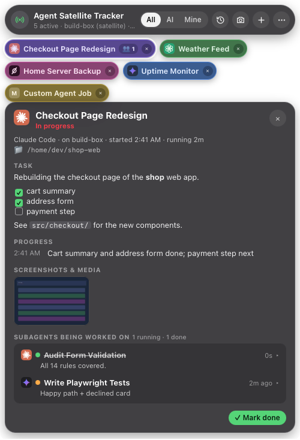

# Orbital Agents - Agent Satellite Tracker for Windows and Linux

The same floating "what is every AI agent working on" panel as the macOS tracker
([`apps/tracker`](../tracker/README.md)), for Windows and Linux satellites. Each machine shows what
ran and is running on it; the hub and the Orbital Agents app see it too.



It is a Python port that is **wire-compatible** with the Mac app:

| | Same as the Mac app |
|---|---|
| HTTP API | `127.0.0.1:<tracker.port>` (7701): `/v1/health`, `/v1/command`, `/v1/start`, `/v1/sub/<parent>`, `/v1/update/<id>`, `/v1/done/<id>`, `/v1/items[?all=1]`, `/v1/items/<id>`, `/v1/media/<item>/<media>`, `/v1/settings` (GET/POST), `/v1/debug/ui`, `/v1/debug/retention`. Same refusals (Origin → 403, foreign Host → 403, non-JSON POST → 415, 16 MB, 10 s). |
| Files | `data/tracker/items.json` (this app is its only writer, atomic replace), `settings.json`, `inbox/` (+ `failed/`), `hub-outbox/`, `media/YYYY-MM/<item>-<media>.jpg`, `icons/<agent>.png`, `logs/tracker.log` (JSON lines), `run/tracker.json`, `run/tracker.lock`. |
| JSON | Swift's encoder byte for byte: sorted keys, `"key" : value`, ISO 8601 dates without fractions, optional fields left out. The Swift CLI decodes and re-encodes our `items.json` to the identical bytes (tested). |
| CLI | `orbital-track` with the same subcommands, flags, stdout, stderr reminders and exit codes. |

So the hub (`orbital/hub/tracker.py`), the iPhone/Mac app and every agent work with it unchanged.

## What's in the panel

- **Bar**: status, *Agent Satellite Tracker*, `N active · <machine>`, **All / AI / Mine**, history ⟲,
  📷 evidence level (grey = Off, green with **1** / **ALL**), **+** type an item, **…** this machine.
  Drag the title to move the panel; it remembers where.
- **Bubbles**: one per item in progress, oldest first, in the item's colour with the agent's icon
  (Claude, ChatGPT/Codex, Grok, Gemini, or a letter for any other agent; drop a logo at
  `data/tracker/icons/<agent>.png` to use it), the running-subagent count, the percent done and an
  **X** (mark done and clear), with a thin progress bar along the bottom. Work in progress pulses.
- **Progress bar**: the same rule as the Mac tracker and the iPhone app (`model.shown_progress`):
  done → 100%; else the agent's `--progress` (`40%`); else ticked `- [x]` boxes out of all
  `- [ ]`/`- [x]` boxes in the details (`~40%`, at most 99); else the subagents' average, counting done
  subagents as 100 (`~40%`, at most 99); else no bar. `~` marks an estimate, which fills dimmer.
- **Details** (click a bubble): who, machine, start time and running time, workspace, the task as
  markdown (task lists, code, links), **Progress** (a full-width bar, the percent and where it came
  from: reported by the agent, estimated from the task list or from subagents, or "waiting for the
  agent's first %"), progress notes, screenshots and videos (click for a lightbox; videos play),
  summary, subagents (click to expand; running ones show a mini bar), **Mark done**.
- **History** (⟲): Today / This Week / This Month / All, search across titles, details, notes,
  summaries and subagents, expandable rows, items per page.
- **Screenshot evidence** (📷): Off / Min 1 / All, shared with the CLI, the hub and the phone through
  `settings.json`; a toast says who changed it.

Not ported (Mac-only today): voice input, Grok titles, global hotkeys, the menu-bar icon.
`/v1/health` reports them as off.

## Install

Needs Python 3.10+.

### Windows 10/11

```powershell
cd orbital-agents\apps\tracker-pc
powershell -ExecutionPolicy Bypass -File scripts\install-windows.ps1 -Start
```

This makes `apps\tracker-pc\.venv`, installs `requirements.txt` (pywebview, which uses the WebView2
runtime that ships with Windows 10/11, and Pillow), adds the folder to your user `PATH` so agents find
`orbital-track.cmd`, writes the install marker, adds a Startup-folder shortcut that runs
`.venv\Scripts\pythonw.exe tracker.pyw` (no console window), and starts it.

Options: `-Autostart Task` (Task Scheduler at sign-in, restarts on failure, instead of the Startup
shortcut), `-Autostart None`, `-NoPath`, `-Python C:\path\python.exe`, `-Uninstall`.

By hand instead:

```powershell
py -3 -m venv .venv
.venv\Scripts\python -m pip install -r requirements.txt
.venv\Scripts\pythonw tracker.pyw                       # the panel
# Startup folder (Win+R → shell:startup): a shortcut to
#   "<this folder>\.venv\Scripts\pythonw.exe" "<this folder>\tracker.pyw"   (Start in: this folder)
# or Task Scheduler:
schtasks /Create /TN "Orbital Agents - Agent Satellite Tracker" /SC ONLOGON /RL LIMITED /TR "\"%CD%\.venv\Scripts\pythonw.exe\" \"%CD%\tracker.pyw\""
```

If WebView2 is missing (rare on Windows 10), install the Evergreen runtime from Microsoft; without it
pywebview falls back to an old engine and the panel may not render.

### Linux

```bash
cd orbital-agents/apps/tracker-pc
# a GUI backend for pywebview, from your distribution:
sudo apt install python3-gi gir1.2-webkit2-4.1          # Debian/Ubuntu (GTK + WebKit)
# sudo dnf install python3-gobject webkit2gtk4.1        # Fedora
scripts/install-linux.sh                                 # venv + deps + ~/.local/bin/orbital-track + XDG autostart
```

The venv is made with `--system-site-packages` so it sees the distribution's `python3-gi`. Prefer Qt?
`.venv/bin/pip install 'pywebview[qt]'` and set `ORBITAL_TRACKER_GUI=qt`.

Autostart choices:

| | |
|---|---|
| `scripts/install-linux.sh` (default `--autostart xdg`) | `~/.config/autostart/orbital-agents-tracker.desktop`: starts with your desktop session (GNOME, KDE, XFCE, …). |
| `--autostart systemd` | `~/.config/systemd/user/orbital-agents-tracker.service`, `WantedBy=graphical-session.target`, restarts on failure. `systemctl --user status orbital-agents-tracker`. |
| `--autostart headless` | the same service with `--headless` and `WantedBy=default.target`: no window, for a server without a desktop. `loginctl enable-linger $USER` keeps it running without a login. |
| `--autostart none` / `--uninstall` | nothing / remove autostart, the PATH link and the marker (data is kept). |

Templates: [`autostart/`](autostart/). On Wayland, "always on top" depends on the compositor (GNOME
ignores it for normal windows; KDE honours it); everything else works.

### Run by hand

```bash
python3 tracker.pyw                 # the panel (same as: python3 -m tracker_pc)
python3 tracker.pyw --headless      # API + inbox + items.json, no window
python3 tracker.pyw --version
python3 tracker.pyw --port 17701    # a second copy next to a running one (tests)
```

One tracker per user: a second copy exits 0 (`run/tracker.lock`). SIGTERM / Ctrl+C saves and exits 0.
If the window can't open (no GUI backend, no display), it logs why and keeps running headless, so
agents' reports still land.

## orbital-track

`orbital-track` (Linux/macOS shell shim) and `orbital-track.cmd` (Windows) run `orbital_track.py`
with this folder's `.venv`, the repo's `.venv`, `$ORBITAL_PYTHON`, or the system Python. Usage is
identical to the Mac CLI ([`apps/tracker/README.md`](../tracker/README.md#orbital-track-the-agent-cli)):

```bash
ID=$(orbital-track start --agent claude --title "Fix Login Redirect" --details "markdown…" [--progress 5])
orbital-track update $ID --progress 40 --note "found it" --media /tmp/shot.png
orbital-track sub $ID --agent claude --title "Audit Routes" [--progress 0]   # subagents → prints SUB_ID
orbital-track update $SUB_ID --progress 50 --note "half the routes checked"
orbital-track done $ID --summary "markdown…" --media /tmp/after.png      # done sets progress to 100
orbital-track evidence [--json] | orbital-track evidence set <off|min1|all>
orbital-track list [--all] [--json]
orbital-track ping
```

`--progress` (0-100, `40%` and decimals accepted) is **required at every update**: it is how far
along the whole job is, and it moves the bubble's bar. An `update` (or `note`) without it still
works (stdout `ok`, exit 0) but prints on stderr, unless `--quiet`:
`orbital-track: add --progress <0-100> to every update so the tracker's bar moves (e.g. --progress 40).`
`start` and `sub` take `--progress` too, and `done` sets 100 on items and subagents.

Delivery is the same too: HTTP to this machine's tracker → `data/tracker/inbox/` → a per-user temp
inbox (`/tmp/orbital-tracker-inbox-<uid>`, or `%TEMP%\orbital-tracker-inbox-<user>` on Windows), and on a
satellite every command also goes to the hub (`POST <hub_url>/v1/tracker/command`, Bearer
`ORBITAL_HUB_TOKEN`, attachments' archived JPEG inline), queued in `hub-outbox/` while the hub is down.
Tracking never blocks an agent: delivery problems warn on stderr, the id is still printed, exit 0.

Media archives: images become a 480 px JPEG (Pillow); videos become a 2×2 frame sheet when `ffmpeg`
and `ffprobe` are on PATH (`winget install ffmpeg`, `apt install ffmpeg`), otherwise the record is
kept without a picture, as the Mac app does for files it can't read.

## Configuration

Everything comes from `$ORBITAL_HOME/config.resolved.json` (`%USERPROFILE%\.orbital-agents` on
Windows), written by `orbital config --apply` / the setup wizard, with the same defaults as
`orbital/core/config.py`: `system.role`, `hub_url`, `machine_name`, `tracker.enabled`, `tracker.port`,
`tracker.history_retention_days` (365), `tracker.media_retention_days` (60), `logging.*`, `paths.*`.
Restart the tracker after changing them.

Environment: `ORBITAL_HOME`, `ORBITAL_TRACKER_GUI` (`qt`, `gtk`, … for pywebview),
`ORBITAL_TRACKER_FOCUS` (`0`/`1`; default 1 on Windows/Linux so the **+** box takes typing, 0 on
macOS), `ORBITAL_TRACKER_DEVTOOLS=1` (web inspector), `ORBITAL_PYTHON` (for the CLI shims).

PC-only additions: `run/tracker.json` also has `"platform"` and `"app": "tracker-pc"`;
`/v1/health` adds `"platform"` and `"ui"`; `GET /v1/media/...?variant=thumb` prefers the archived
JPEG (the panel uses it for video thumbnails); media answers support `Range`; `/v1/debug/ui` takes
`view, select, expand, range, filter, query, page, pageSize, menu, typing, submitTyped, openSubs,
lightbox, click, move, showPanel, toast` and returns the panel's frame; `data/tracker/installed.json`
(written by the installers, `tracker.pyw --install-marker`) says a tracker is installed here even
while it isn't running.

## For the satellite: detecting this tracker

`capabilities.tracker` should be true on Windows/Linux when either file exists:

- `<paths.run>/tracker.json` — written while the tracker runs (removed on a clean exit), same as macOS;
- `<paths.tracker_data>/installed.json` — written by the installers (`--install-marker`), removed by `--uninstall`.

## Tests

```bash
.venv/bin/pytest apps/tracker-pc/tests -q          # from the repo root
```

They run a headless tracker on a free port against a temporary `ORBITAL_HOME` (never
`~/.orbital-agents` or 7700-7704) and check the API, the refusals, items.json/settings.json/inbox/media
formats, retention, the CLI (including the satellite relay against a fake hub), the hub's own
`TrackerFeed` reading our files and relaying commands to us, and, when `apps/tracker` has been built
(`swift build`), the real Swift `orbital-track` against this server and byte-identical output from both CLIs.

## Layout

```
tracker.pyw             start the tracker (pythonw on Windows: no console)
orbital_track.py        the agent CLI; orbital-track / orbital-track.cmd are the shims
tracker_pc/
  app.py                process: lock, run file, HTTP, inbox, retention, settings, signals, main()
  server.py             the loopback HTTP API and the inbox scanner
  store.py              the single writer of items.json (start/sub/update/done, media, retention)
  model.py              schema, Swift-identical JSON, ids, dates, evidence levels, inbox names
  media.py              480 px JPEG archives, video frame sheets, inline archives from the hub
  relay.py              satellite → hub relay and its outbox; urllib helper
  config.py             config.resolved.json, paths, secrets.env
  jsonlog.py            logs/tracker.log JSON lines
  ui/                   the pywebview panel (panel.html / .css / .js)
autostart/              XDG .desktop and systemd --user templates
scripts/                install-windows.ps1, install-linux.sh
tests/                  pytest
```
