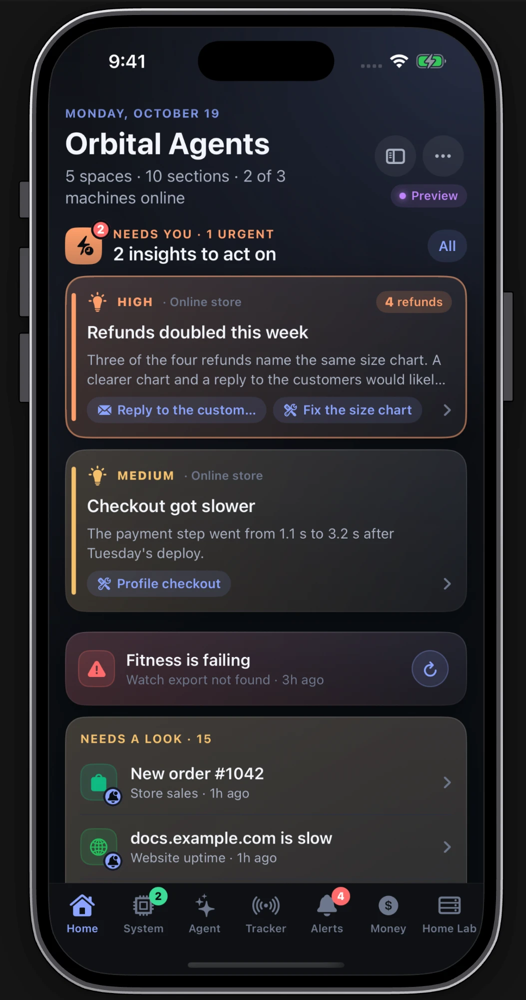
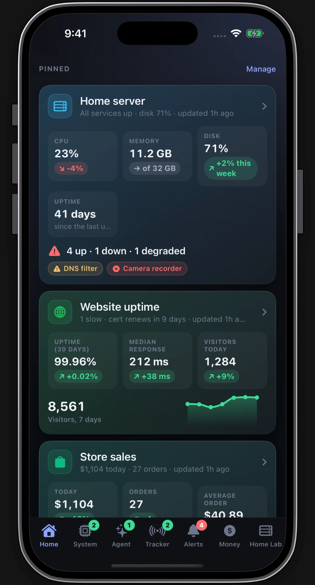
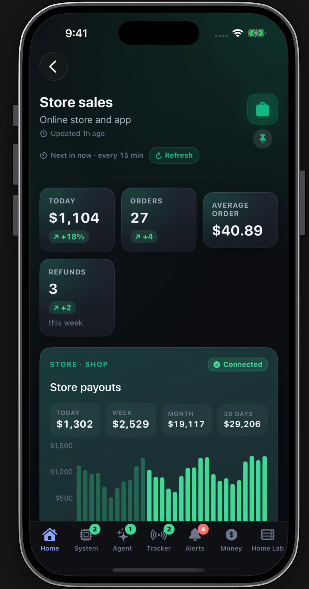
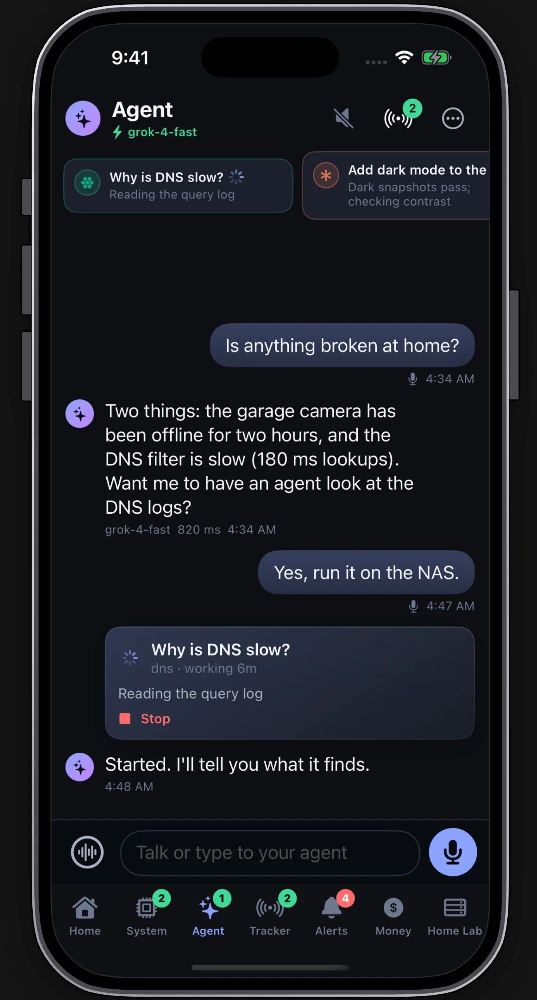
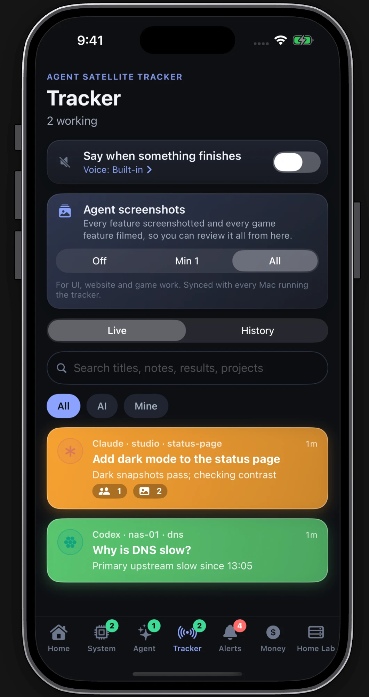
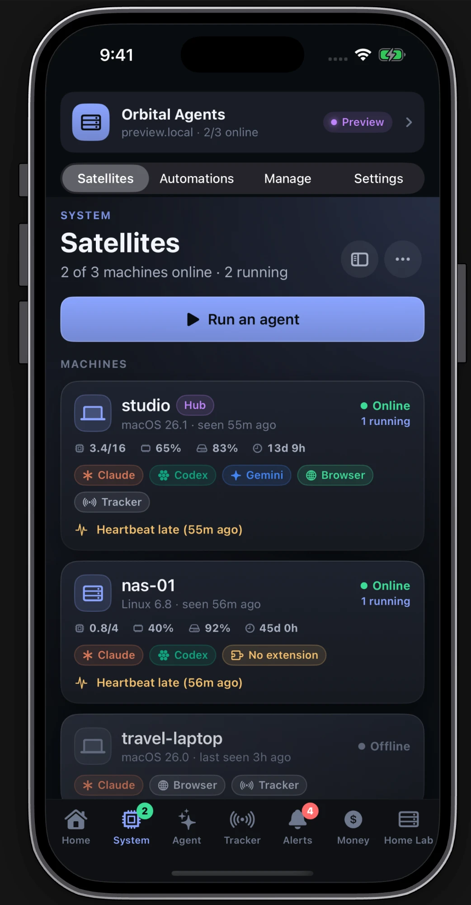
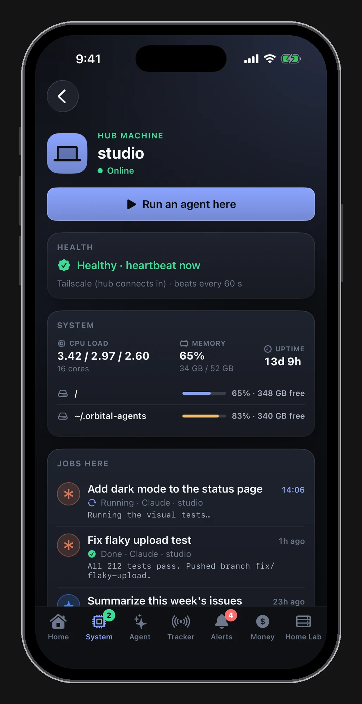
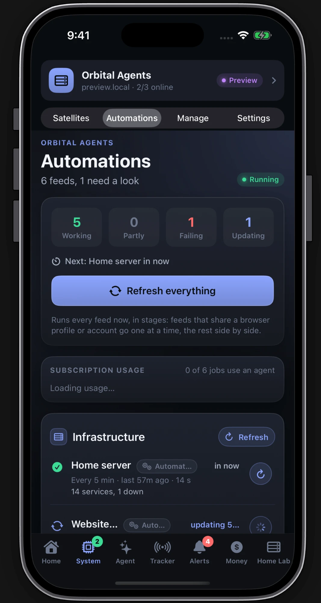
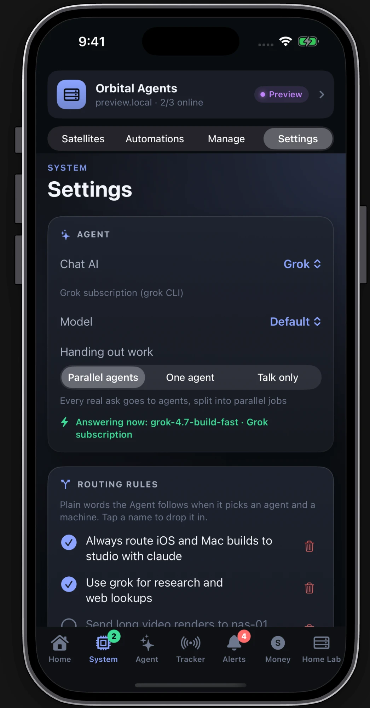
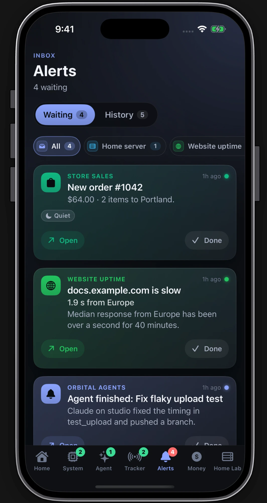

# The Orbital Agents app (iPhone, iPad, Mac)

One SwiftUI app, built for iPhone and iPad and, from the same target, for the Mac (Mac Catalyst). It shows what the hub knows: your feeds' pages, alerts, every machine and its agent jobs, the tracker, and the Agent desk. It talks only to your hub, over Tailscale. The source and its build notes are in [`apps/orbital-app/`](../apps/orbital-app/README.md).

| Home | Pinned pages | A feed's page | Agent | Tracker |
|:---:|:---:|:---:|:---:|:---:|
|  |  |  |  |  |
| **Satellites** | **A machine** | **Automations** | **Agent settings** | **Alerts** |
|  |  |  |  |  |

The screenshots use the sample data in `apps/orbital-app/Fixtures/preview` (preview mode, no hub; `apps/orbital-app/scripts/screenshots.sh` takes the basic set).

## iPhone, iPad and Mac

On **iPhone** the bottom bar always has these controls:

| Tab | Shows |
|---|---|
| **Home** | what needs you, what the agents are doing, pinned pages, one tile per space, live values |
| **Money** | every ledger added up: today, this week, this month, this year and all time, a chart, and a row per business you can tap into ([Money](#money)) |
| **System** | the hub at the top, then **Satellites** (every machine with its CPU, memory, disks, uptime, agents, browser and jobs, and **Run an agent**), **Automations** (every feed, plain script or agent run, with subscription usage), **Manage** (sections) and **Settings** |
| **Agent** | talk or type; a fast model on your subscription answers and hands real work to agents on your machines |
| **Tracker** | the Agent Satellite Tracker's items, live and history, with progress and token use |
| **Alerts** | the alerts inbox |
| **Sections** | opens the spaces-and-pages drawer so you can dive into any section, space, or hub nav item from the bottom bar |

Extra tabs after these (a space, a page, a group of pages) come from the hub's navigation document, set with `orbital nav set <file>`; `orbital nav example` prints one to start from. The app picks up a change on its next refresh, with no update. Money is built in, so a nav item that opens the `money` view (or is named Money) is left off the bar; in the sidebar it opens the same screen.

While you type (for example in the Agent field), the full tab bar steps aside for the keyboard and a slim strip with **Sections** and **Done** stays at the bottom. Tap **Done**, the keyboard's Done, or the thread above the field to dismiss the keyboard and bring the tab bar back; you do not need to force-close the app.

The Alerts tab carries a red badge with the number of alerts waiting. System, Agent and Tracker show a green count of the work running there. Pages open on the current tab's stack. Tapping the current tab again goes back to its top.

On **iPad and Mac** the same screens sit in a sidebar instead of tabs:

- the top of the sidebar: Home, Money, System, Agent, Tracker and Alerts
- below them: your spaces
- then every section, with a pin on the ones pinned to Home
- at the bottom: Automations, Manage and Settings

The chosen screen opens beside the sidebar. A section with a sidebar layout adds a middle column listing its pages. On the Mac the window opens at 1280 × 860 and won't shrink below 960 × 620. The Mac app is the iPhone target built for Mac Catalyst: same features, same bundle id, same sign-in.

## Money

The **Money** tab adds up every `ledger` block across your sections ([DATA_PIPELINE.md](DATA_PIPELINE.md#ledger)), in the currency most ledgers use; a ledger in another currency is listed but left out of the totals.

- **Totals:** the chosen range with its change against the same span before, and tiles for today, this week, this month, this year and all time. Tap a tile to pick that range.
- **Chart:** bars by day (by month for ranges over three months), stacked by business, then by product inside a business.
- **By business** and **By product:** each with its share. Tap one to open the same screen narrowed to it: a business shows its products and sources, a product its sources and categories, and so on down to single categories.
- **Payments** and **Every entry:** single payments the feeds sent, then every ledger day.
- **Where it comes from:** each ledger, connected or not, and when it last reported. Tap one for its page.
- **Filters:** the date range (today, week, month, 30 days, year, all time, or custom dates), income, refunds or payouts, and **Filter** for business, product, source and category. **Show all** clears them. Payouts (a category naming a payout) are money already counted when it came in, so they show only when you pick Payouts; refunds are a refund category or a negative amount.

A product with a `subscriptions` block gets a **Subscriptions** card on Money, on its product page and on its space. Tap it for subscribers and MRR, trials and when each ends, new, cancelled and churned subscriptions and failed payments for the period you pick, a chart of paying subscribers over 90 days, and every subscription with its plan, status, start, and renewal or end date. It shows only what the feed sends: a customer's email or id, never card details.

`orbital://money`, `orbital://money?business=<space>&product=<name>` and `orbital://subscriptions?product=<name>` open these screens.

## Connect and sign in

1. Install Tailscale on the phone (or Mac) and sign in to the same tailnet as the hub.
2. Open the app. When the hub's setup finished it printed an `orbital://connect?hub=…` link (and a QR code when `qrencode` is installed). Open the link or scan the code: it fills in the hub address. Or type the address yourself: `http://<hub-name>.<your-tailnet>.ts.net:7700`. An address without a port gets `:7700`.
3. Sign in with the username and password from the hub's `~/.orbital-agents/secrets.env` (`ORBITAL_HUB_USERNAME`, `ORBITAL_HUB_PASSWORD`). The wizard can generate the password; it says where it put it.

The sign-in screen checks the address first (`GET /v1/hub/info`), so it says what is wrong:

- An unreachable hub gives "Can't reach the hub. Is Tailscale on, on this device and the hub, and is the hub running?"
- A refused network says the hub only answers loopback and Tailscale addresses.
- A wrong password says so.

If you are already signed in and open a connect link for a different hub, Settings opens with a card asking whether to switch.

The app keeps its session token in the Keychain. If the Keychain refuses an unsigned Mac build, the token goes in a file only you can read under `~/Library/Application Support/<app name>/secrets`. Sessions unused for `hub.data_retention_days` (90) are signed out. Change the password or sign every device out: [SECURITY.md](../SECURITY.md#rotating-tokens).

## Home

Top to bottom:

- **The header:** the hub's name (`system.name`), the date, and a count of spaces, sections and machines online. A **Preview** or connection pill shows how the app is connected.
- **Needs you:** open insight cards from your feeds, most urgent first. Each card has its actions, such as replying to an email or starting an agent with a prepared brief, plus Snooze and Dismiss. These post back to the feed that raised it.
- **Automations**, when a feed is failing: which one and why (its last error). Tap it to see the feed, or tap the refresh button to run every feed now.
- **Needs a look:** the attention list. It covers:
  - unread alerts
  - machines offline, and agent jobs that failed in the last day
  - services reported down or degraded by `status` blocks
  - to-dos due or overdue
  - app releases waiting on a store, products whose data went stale, and money sources that disconnected

  When there is nothing, it says "All clear".
- **Agents:** each machine as a chip (online or not, with its running count), the jobs running now with their elapsed time, live tracker items, and **Run an agent**.
- **Pinned:** the pages you pinned, each with its headline figures (the first metrics, status, progress or chart on the page).
- **Spaces:** one tile per space (a project, a household, a server fleet) with its sections.
- **Live now:** short-lived values feeds post with `pulse`, such as CPU now, visitors online and orders today.
- **All sections:** the full list.

Pull down anywhere to refresh.

## Spaces and pages

A **space** groups sections: its sections, its products, the charts of every section in it side by side (visitors, stars, revenue, …) and its money.

- **Where spaces come from:** the hub's `spaces` list, each section's `space` (with `space_title` and `space_icon`), and the space named on product, series and ledger blocks.
- **Space colours:** each space keeps the same colour everywhere, taken from its name unless the feed sets one.

A **page** is a section your feed pushed, drawn block by block: figures, charts, tables, timelines, status rows, progress bars, to-do lists, money, products with their store releases and reviews, insight cards, video posts, images, and buttons ([DATA_PIPELINE.md](DATA_PIPELINE.md)). How the page is laid out:

- **Layout:**
  - A section is a single page, a set of tabs, or a sidebar of pages.
  - A tabs or sidebar section's own blocks are a summary that sits above every tab and page.
- **Under the title:**
  - when it was updated
  - which feed writes it, with a countdown to its next run and a **Refresh** button
  - a pin
- **Tapping items:**
  - To-dos tick off and can be added to. The tick is sent to the feed, which writes it back to its source.
  - Buttons open the Desk with a prompt, open another page or a link, start an agent, or send an action to the feed (`server.restart`, say). An action asks first when the feed set `confirm`, and shows as pending until the feed answers.

## Pin to Home

Tap the pin under a page's icon, or use **Pin to Home** in Manage sections. Pins are shared with every device signed in to the hub (`/v1/prefs`, `pinned_sections`), in the order you pinned them. Unpin the same way.

## Agents

The Agents screen lists every machine. For each one it shows:

- online or offline, and when it was last seen
- its OS
- the agent CLIs it offers (Claude, Codex, Gemini, Grok, …)
- whether it offers browser control and the tracker
- how many jobs it is running

Below the machines is every job, with a filter for **All**, **Running** or **Failed**. The screen refreshes on pull, on a timer, and live as the hub reports jobs.

- **A machine's page:** its details (system, host, address, version, joined, last heartbeat, browser control, tracker), its agents with their state, its jobs, **Run an agent here**, and Remove.
- **A job's page:** the agent, machine, folder, status and running time. It also has **Stop**, **Run again** and **Tracker**, the prompt with a copy button, and the output. While the job runs, the output refreshes every 3 seconds; **Follow new output** keeps the newest lines in view.
- **Run an agent:** asks for:
  - the machine (only online ones)
  - the agent (the ones installed there; Claude when it is there)
  - the prompt
  - an optional working folder (inside the machine's `satellite.workdirs`)
  - an optional title for the tracker

  Then it opens the new job. It is also on Home, in the Desk's menu, on each machine's page, on feed buttons with `run_agent`, and behind `orbital://run?machine=…&agent=…&prompt=…`. More: [SATELLITES.md](SATELLITES.md#run-an-agent-on-another-machine).

## Desk

One running conversation with the hub's desk model. Type, or tap the microphone, talk, and tap it again to send. The **waveform** button turns on hands-free, which keeps listening for a back-and-forth. The speaker button turns spoken replies on and off. The desk answers in a sentence or two and hands real work to agents on your machines. Those tasks show in a strip along the top with their progress, and in the thread with a Stop button. Their results come back in the thread.

The agents report back while they work. Ask "how's the login fix going?" and the desk answers from the agent's own progress and notes. Ask "read me the email it drafted" and it reads it from the agent's report. A quick question ("how many orders came in today?") goes to an agent told to look it up fast, and you hear the answer the moment it has it. When an agent needs you ("which account should I use?"), the desk asks you out loud, and your answer goes straight to that agent while it keeps working. Anything you add to a running task reaches it within seconds.

The **…** menu has Run an agent, Voice settings, Refresh, and Clear context (starts the conversation fresh). **Voice settings** chooses:

- speech to text: Apple's on-device recognizer, an on-device Whisper model downloaded from the hub (iOS 18), or OpenAI or Azure with your own key
- the voice: Apple, the hub's Fish Audio voices (the key stays on the hub), or Azure
- the microphone and speaker route
- smart glasses and the car

The Agent tab answers with the subscriptions already signed in on the hub: the Grok CLI (a warm `grok agent stdio` session, about 2 s to the first words), then the Claude CLI, then the Mac's built-in Apple model, so it works with no API key. An engine that is out of credits or signed out is skipped until it answers again, and the reason shows in the app. `XAI_API_KEY` in `~/.orbital-agents/secrets.env` puts xAI's paid API first. `desk.provider = "off"` in `config.toml` turns the Agent off.

## Tracker

The same items as the floating Agent Satellite Tracker on your Mac:

- **Live and History**, a search over titles, notes, results and projects, and a filter for **All**, **AI** or **Mine**.
- **An item's page:** its details, the progress notes, screenshots and videos (full screen), subagents, and the result.
- **Settings at the top of the tab:**
  - **Say when something finishes** speaks finished items in the chosen voice.
  - **Agent screenshots** sets the evidence level agents follow (Off, Min 1 or All). It is shared with every Mac running the tracker.

## Alerts

The inbox, with these parts:

- **Waiting and History** with counts, plus a chip for each page that raised alerts, so you can see one page's alerts or clear them all at once.
- **Each alert** shows its page, when it came, and **Open** (to the page, node and tab it points at) and **Done**. Long-press for the same. Clearing an alert clears it on every device.
- **Reminders** scheduled on this device for later are listed apart until they come due.
- **Test notification** builds a real notification with any mix of image, subtitle, sound, badge, Open, Reply, Snooze, Dismiss, time-sensitive, grouping and a deep link. It goes out now or in 10 seconds (lock the phone to see the Lock Screen). The card leads an empty inbox and sits below real alerts otherwise.

## Automations

Every feed the scheduler runs, grouped as the feeds declare. Reach it from Home's **…** menu, the sidebar, or the Automations card.

- **Scheduler status:** whether it is running, and what is updating now.
- **Refresh everything:** runs every feed in stages. Feeds that share a browser profile or an account run one at a time.
- **A Refresh button per group.**
- **Each feed** shows its countdown, last result and a run button.
- **A feed's page** has:
  - its next update
  - **Run now** or **Stop**, and **Pause** or **Resume**
  - the last run (result, duration, exit code), the recent runs, and the last fully working run
  - **How often** it runs, and the account lane it shares
  - the pages it updates
  - its log

It also warns when the hub's disk is nearly full or the scheduler has stopped. More: [FEEDS.md](FEEDS.md).

## Manage sections

From Home's **…** menu or the sidebar:

- create a section (id, title, subtitle, space, SF Symbol, accent colour, layout)
- edit one
- move one up or down
- pin or unpin one
- delete one

A feed creates its section again on its next push, so this is for tidying, not for content.

## Settings

- the account (who is signed in, which hub, the connection, reconnect)
- the hub address, with **Save and reconnect**: a different address signs you out so you can sign in to that hub
- the hub's name, machine and version
- notifications: the system permission, a test alert, and a link to the system settings
- **Voice settings**
- the app's version
- **Sign out**

## Notifications

Alerts reach the device three ways, and any one is enough:

- **The live connection** brings them in as soon as they are raised while the app is open, and also shows a banner inside the app.
- **Background refresh** turns new alerts into notifications and schedules reminders on the device, so a reminder fires on time even when the hub is out of reach.
- **Direct Apple push** (optional) delivers them within seconds when the app is closed.

The notification buttons work from the Lock Screen: Open, Reply (opens the Desk with your text), Snooze, Done, and actions your feeds add.

Turning on push takes four things:

- a paid Apple developer account
- an APNs key on the hub, with `notifications.apns = true`
- a Team ID in the app's settings, so the generator adds the push entitlement
- signing in again

When the hub reports push on (`/v1/health`, `apns.enabled`), the app asks iOS for a device token and registers it with the hub (`POST /v1/devices`, `apns_token`, `platform`). Tapping a push opens its alert's page. A push and the background refresh never show the same alert twice. Without push nothing else changes, so free accounts still build. Details: [NOTIFICATIONS.md](NOTIFICATIONS.md).

## Links

The app opens `orbital://` links from anywhere: Safari, Notes, a feed's button, a notification, Shortcuts.

| Link | Opens |
|---|---|
| `orbital://connect?hub=<address>` | sign-in with the hub address filled in |
| `orbital://home` | Home |
| `orbital://open?section=<id>&node=<id>&tab=<id>` | a page (node and tab optional) |
| `orbital://space?id=<space>` | a space |
| `orbital://agents`, `orbital://agents?machine=<name>`, `orbital://agents?job=<job id>` | Agents, a machine, a job |
| `orbital://run?machine=<name>&agent=<cli>&prompt=…&cwd=…&title=…` | Run an agent, filled in |
| `orbital://desk?prompt=…` | the Desk with a prompt in the box |
| `orbital://tracker`, `orbital://tracker?id=<item>` | the Tracker, an item |
| `orbital://alerts`, `orbital://automations`, `orbital://settings` | those screens |

## Build and install

You need a Mac with macOS 14 or newer and full **Xcode** (for the Mac app and the iPhone app). The setup wizard asks for your Apple Developer **Team ID** and a **bundle id prefix**, then builds and installs the Mac app and, when an iPhone is connected, the iPhone app. You can also run the scripts yourself:

| Command | Does |
|---|---|
| `apps/orbital-app/scripts/build.sh [--mac \| --all] [--release]` | unsigned builds for the iOS Simulator and/or Mac Catalyst; no Apple account needed |
| `apps/orbital-app/scripts/deploy-mac.sh [--open] [--no-install] [--debug]` | builds the Mac app (Release, Mac Catalyst) and installs it as `/Applications/<app name>.app`, `Orbital Agents.app` by default (`ORBITAL_MAC_APP_DIR` for another folder); it never replaces a different app with the same name |
| `apps/orbital-app/scripts/deploy-iphone.sh [--device NAME] [--no-launch] [--no-install] [--release]` | builds signed with your Team ID and installs on a connected iPhone or iPad with `xcrun devicectl` |
| `apps/orbital-app/scripts/test.sh [--device NAME \| --mac]` | the app's unit tests, unsigned |
| `apps/orbital-app/scripts/screenshots.sh [--device NAME] [--out DIR]` | runs the app in preview mode (sample data, no hub) on a simulator and saves screenshots of the main screens |
| `python3 apps/orbital-app/generate_xcodeproj.py [--print] [--icons]` | (re)generates `OrbitalAgents.xcodeproj`; `--print` shows the settings it would use, `--icons` rebuilds the app icons from `docs/assets` |

The Xcode project is generated, not committed, because it carries your Team ID and bundle id. Settings come from, in order: the generator's flags (`--team`, `--bundle-prefix`, `--app-name`, `--apns` / `--no-apns`, `--apns-environment`), the environment (`ORBITAL_TEAM_ID`, `ORBITAL_BUNDLE_PREFIX`, `ORBITAL_APP_NAME`, `ORBITAL_APNS`, `ORBITAL_APNS_ENVIRONMENT`), then `~/.orbital-agents/config.resolved.json` (`apple.team_id`, `apple.bundle_prefix`, `apple.app_name`, `notifications.apns`, `notifications.apns_environment`).

- The bundle id is `<apple.bundle_prefix>.orbitalagents` (the tests: `….tests`). Pick a prefix only you use, like `com.yourname`.
- `deploy-iphone.sh` picks the device from `--device`, else `apple.ios_device` (or `ORBITAL_IOS_DEVICE`), else the first connected iPhone. The phone must be paired (connect it by cable once and tap **Trust**) and in **Developer Mode** (Settings → Privacy & Security).
- A **free Apple account** works: Xcode makes a 7-day profile, so re-run the deploy script once a week. A paid developer account signs for a year and is needed for direct Apple push.
- The push entitlement is only added when `notifications.apns` is on, so a free account can still build the app. See [NOTIFICATIONS.md](NOTIFICATIONS.md).
- Build logs from the wizard: `~/.orbital-agents/logs/setup-mac app.log` and `setup-iphone app.log`.

Signing problems and their fixes: [TROUBLESHOOTING.md](TROUBLESHOOTING.md#iphone-build-and-signing-errors).

## The Agent Satellite Tracker (Mac)

The floating panel is a separate, small macOS app in `apps/tracker/` (a Swift package, no Xcode project needed):

```bash
cd apps/tracker
scripts/build.sh                 # build/Orbital Agents - Agent Satellite Tracker.app
scripts/install.sh               # build, copy to /Applications, link ~/.local/bin/orbital-track
scripts/install.sh --dest ~/Applications --open
```

It needs macOS 14 and the Swift 6 toolchain (Xcode 16 or its Command Line Tools). The setup wizard builds it for you and `orbital services install` starts it at login. Everything about it, including the `orbital-track` CLI, voice input, keyboard shortcuts and the evidence level: [`apps/tracker/README.md`](../apps/tracker/README.md).
