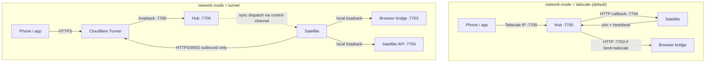
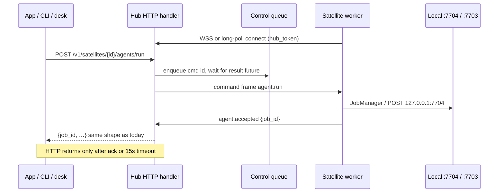

# Dual network modes: Tailscale and Hub-relay / outbound tunnel

| Field | Value |
|---|---|
| **Author** | TBD |
| **Date** | 2026-03-26 |
| **Status** | Draft (revised after design review) |
| **Related** | `docs/ARCHITECTURE.md`, `docs/SATELLITES.md`, `docs/SETUP.md`, `docs/CONFIG.md`, `SECURITY.md` |

---

## Overview

Orbital Agents today assumes a **Tailscale mesh**: every machine discovers peers with `tailscale status`, binds satellite (7704) and optionally browser (7703) services to Tailscale IPs, and the hub (`Registry.base_url` in `orbital/hub/satellites.py`) **calls back** to each satellite over that overlay. `hub.allow_networks` / `satellite.allow_networks` accept only loopback and Tailscale CGNAT ranges. That model is secure and simple for users who already run Tailscale, but it is a hard requirement for multi-machine setups and for the phone reaching the hub.

This design adds a second, first-class mode — **hub-relay + outbound tunnel** — so a user can run one hub and many satellites **without Tailscale**. The hub is published only through a private tunnel hostname (Cloudflare Tunnel in v1). Satellites open **outbound HTTPS/WSS only** to that hostname. Agent runs and remote browser control are delivered through a **pull-based control channel** on the hub; satellites never accept inbound connections from the internet, and ports 7700–7704 are never Funnelled or port-forwarded.

App-facing HTTP shapes stay **truly unchanged**: hub handlers that today `await call(...)` instead `await dispatch(...)`, which **blocks until the satellite acks** (or times out with 502). Setup stays wizard- and answers-file driven, with copy-paste “AI agent setup prompts” so a user can hand each machine to any agent CLI.

---

## Background & Motivation

### Current state (verified in repo)

| Concern | Today |
|---|---|
| Discovery | `orbital/satellite/discover.py` → `tailscale_peers()` → probe `GET /v1/hub/info` |
| Hub allow list | `AllowNetworks` middleware (`orbital/hub/web.py`); defaults in `orbital/core/config.py` = loopback + `100.64.0.0/10` + `fd7a:115c:a1e0::/48` |
| Satellite bind | `satellite.bind = "tailscale"` → listen on Tailscale IP + loopback (`orbital/satellite/server.py`) |
| Browser bind | `browser.bind = "loopback"\|"tailscale"` (`orbital/browser/server.py`) |
| Join | `POST /v1/satellites/join`; hub requires reported `ip` ∈ `hub.allow_networks` (`Registry.join`) |
| Hub → satellite | `Registry.base_url(row)` = `http://{ip}:{port}`; `call()` via httpx (`satellites.py`) |
| Hub → browser | `Registry.browser_url(row)` + fleet `ORBITAL_BROWSER_TOKEN`; bridge must `bind = "tailscale"` for direct/relay reachability; readiness errors say “set browser.bind = tailscale” (~line 544) |
| Heartbeat | Satellite → hub outbound (`orbital/satellite/heartbeat.py`) — already outbound-friendly |
| Doctor | `check_tailscale` fails satellites without Tailscale (`orbital/cli/commands/doctor.py`) |
| Wizard | Role/discovery/Tailscale preflight; no network-mode choice (`orbital/wizard/flow.py`) |
| Security stance | “Nothing listens on the public internet”; never Funnel (`SECURITY.md`) |
| Uvicorn | Hub runs with `proxy_headers=False` (`orbital/hub/__main__.py`) — tunnel connector appears as **loopback** |
| Login | `POST /v1/login` — **no rate limit** today |
| Unauthenticated | `GET /v1/health`, `GET /v1/hub/info` (name, machine, hub_id, version) |
| Phone HTTPS | `OrbitalStore.parse("https://…")` keeps HTTPS and does not append `:7700`; `LiveSocket` maps https→wss; media URLs are **path-relative** |
| `Config.hub_url()` | Role hub always returns `http://127.0.0.1:<port>` (correct for local feeds; **wrong** for invite text in tunnel mode) |

### Pain points

1. Users who refuse Tailscale (policy, complexity, another daemon) cannot run a multi-machine fleet.
2. Phone/iOS reachability without Tailscale has no supported path (app needs a hub URL on the allow list).
3. Hub→satellite callback is the structural blocker for “outbound-only satellites”: agent run and browser relay both `call()` the satellite’s published IP today.
4. Setup messaging assumes Tailscale everywhere (`SETUP.md`, `SATELLITES.md`, doctor, skills, app placeholders).

### Why not just “open 7700 on the LAN / public IP”?

Forbidden by product security: ports 7700–7704 must never be exposed on the public internet. A tunnel hostname that terminates TLS at the edge and connects **only** to `127.0.0.1:7700` on the hub machine preserves the “no public bind of Orbital ports” rule while giving the phone and satellites a stable HTTPS URL.

---

## Goals & Non-Goals

### Goals

1. Support **`network.mode = "tailscale"`** (default, current behaviour) and **`network.mode = "tunnel"`** (new).
2. In tunnel mode, satellites need **only outbound HTTPS/WSS** to the hub tunnel URL; no inbound ports, no Tailscale, no per-satellite tunnel required for v1.
3. All remote agent runs and remote browser control in tunnel mode go **through the hub** (already the app/CLI path for agents; browser becomes hub-only, never direct).
4. Hub published via **Cloudflare Tunnel** in v1 (**named tunnels** for real fleets; quick tunnels for demos only).
5. Wizard + `answers.toml` + printable **AI agent setup prompts** + `orbital network tunnel …` helpers make setup “super easy”.
6. Keep existing app-layer tokens (join, hub, satellite, browser, automation) unchanged in meaning; keep **HTTP request/response shapes** for agent and browser relays unchanged (sync wait for satellite ack).
7. Update docs (`AGENTS.md`, `ARCHITECTURE.md`, `SETUP.md`, `SATELLITES.md`, `CONFIG.md`, `SECURITY.md`), doctor, wizard copy, skills, and **iOS/Mac app hub URL copy**.
8. Harden tunnel mode’s internet-facing surface: **login and join rate limiting in this epic**; dual-perimeter threat model in SECURITY.md.
9. Tests continue to use temp `ORBITAL_HOME` and free ports; examples stay generic.

### Non-Goals (v1)

- Replacing Tailscale for users who already like it.
- Satellite↔satellite direct mesh in tunnel mode.
- Exposing tracker (7701), STT (7702), browser (7703), or satellite (7704) through the tunnel.
- Full provider abstraction with pluggable tunnel backends in v1 (leave seams only).
- Renaming every `bind = "tailscale"` string to a neutral term in v1 (avoid a large breaking rename; document aliases).
- Running Orbital’s own reverse-proxy or issuing public certificates (Cloudflare does TLS).
- Changing the iOS/Mac app’s auth model (still username/password → session token).
- Multi-hub or hub failover.
- **Owning `cloudflared` as a managed Orbital service** in v1 (wizard prints install/run steps + optional LaunchAgent snippet; doctor verifies; a follow-up may install a LaunchAgent).
- **Automating Cloudflare Access** in the wizard (advanced docs only).
- **Mixed-mode fleets** (some machines Tailscale, some tunnel) — unsupported; one `network.mode` per hub.

---

## Key Decisions

| # | Decision | Rationale |
|---|---|---|
| K1 | **Two explicit modes** via `network.mode`: `tailscale` (default) \| `tunnel` | Keeps Tailscale path unchanged; avoids implicit “no Tailscale → half-broken” behaviour. Doctor and wizard branch cleanly. |
| K2 | **Hub→satellite in tunnel mode = satellite pull channel** (WebSocket preferred on macOS/Linux; **long-poll first on Windows** if WS is flaky — see K13) | Matches “outbound only from satellites”. Avoids per-satellite Cloudflare tunnels and reverse-SSH. |
| K3 | **v1 tunnel provider = Cloudflare Tunnel; named tunnels for real fleets** | Stable hostname so `hub.url` / phone URL survive restarts. Quick tunnels (`*.trycloudflare.com`) are **demo/smoke only**; wizard steers hard away from them for lasting setups. |
| K4 | **Tunnel ingress = only hub `:7700` on loopback** | Preserves “never expose 7701–7704”. `cloudflared` → `http://127.0.0.1:7700`; hub `AllowNetworks` still sees loopback (`proxy_headers=False`). App-layer auth is the internet-facing control plane — hardened per K12. |
| K5 | **Remote pull satellites store no callback `ip`/`port`; hub-local stays `callback` + `127.0.0.1`** | Prevents every tunnel satellite registering as `127.0.0.1` and accidentally hitting the hub’s own :7704/:7703. `base_url`/`browser_url` must never be used when `reachability != "callback"`. |
| K6 | **Keep token model as-is** | Join / hub / satellite / browser / automation tokens already fit; the pull channel authenticates with the existing hub_token. |
| K7 | **Do not wholesale rename `bind=tailscale` in v1** | Tunnel mode forces `loopback`. Optional alias `overlay` later. |
| K8 | **Phone uses `https://<tunnel-hostname>` + existing login** | App already parses HTTPS without forcing `:7700` and maps wss. Update placeholders/copy; media/tracker URLs are path-relative and resolve against the app’s hub base URL. |
| K9 | **Setup UX: wizard + answers + agent prompts + CLI helpers + doctor repair loop** | Named-tunnel default; verify HTTPS + WSS; printable prompts include phone URL and “do not expose 7701–7704”. |
| K10 | **Ship incrementally via stacked PRs** (see PR Plan) | Split control channel; dedicated security and blob PRs. |
| K11 | **`dispatch()` is synchronous for the HTTP caller** | Hub HTTP handlers **await** satellite `agent.accepted` (or equivalent) and return the **satellite-generated `job_id`**, timeout **15s** (same as today’s `call(..., timeout=15)`). True “API unchanged” for app/CLI/`desk_tasks`. No hub-side job id namespace. |
| K12 | **Login + join rate limiting ship in this epic**; SECURITY.md becomes dual-perimeter | Tunnel mode makes `/v1/login` and `/v1/satellites/join` world-reachable. GA blocked on both rate limits + documented public surface. Cloudflare Access = **advanced/optional docs only** (not wizard-automated). Normative login keys: see Login rate limiting section. |
| K13 | **In-memory control queues for v1; Windows prefers long-poll** | Queues die with the hub process (commands fail open). Avoids durable queue complexity. On Windows, satellite worker uses long-poll as the primary transport if WS upgrade fails or is unreliable; macOS/Linux prefer WS with long-poll fallback. |
| K14 | **Large browser blobs are bidirectional out-of-band HTTPS, not control frames** | **Uploads/`stage`:** hub stores object; satellite pulls (`browser.stage_fetch`). **Results** (`screenshot`, `files_read`, `export`, and any result whose encoded JSON would exceed the control soft cap): satellite uploads to hub staging; control ack returns `{result_ref}`; hub HTTP handler materializes the same response shape the client sees today. Soft cap on control frames remains **1 MiB** either direction. |
| K15 | **Single `external_hub_url()` helper** | Tunnel → `network.public_url`; Tailscale invite → MagicDNS/`hub.url` display. Invite, wizard, `orbital satellites invite`, and agent-prompt **must not** emit `http://127.0.0.1:7700`. |
| K16 | **Pull satellites are “ready for work” only when `control_connected`** | Heartbeat still updates `last_seen` for liveness history, but listing/`orbital satellites` / app ready-state for pull rows uses `control_connected` (show both columns; do not offer Run if control is down). Doctor warns on control peers. Avoids “online but agents/run → satellite_offline”. |

---

## Proposed Design

### Mode comparison



### Config surface

New section in `orbital/core/config.py` `DEFAULTS` and `config/orbital.example.toml`:

```toml
[network]
mode = "tailscale"                 # tailscale | tunnel
# tunnel mode only:
public_url = ""                    # https://orbital.example.com  (no trailing slash, no :7700)
tunnel_provider = "cloudflare"     # v1: only cloudflare; reserved for later providers
tunnel_id = ""                     # Cloudflare named tunnel id (informational)
cloudflared_config = ""            # path to cloudflared config.yml if non-default
```

Related writes:

| Mode | External hub URL (`external_hub_url()`) | `hub.allow_networks` | `satellite.bind` | `browser.bind` |
|---|---|---|---|---|
| `tailscale` | `http://<magicdns>:7700` (invite) | loopback + Tailscale CGNAT | `tailscale` (default) | `loopback` or `tailscale` |
| `tunnel` | `network.public_url` (`https://…`) | **loopback only** | **`loopback`** (forced) | **`loopback`** (forced) |

**`external_hub_url(cfg)`** (new helper on `Config` or `orbital.core.net`):

- Hub + tunnel → `cfg.get("network.public_url")` (required non-empty after setup).
- Hub + tailscale → MagicDNS/`tailscale_self` + `hub.port`, else hostname.
- Satellite → always `cfg.get("hub.url")` (what this machine uses to reach the hub).
- **Never** return `http://127.0.0.1:…` for invite / agent-prompt / phone instructions.

`Config.hub_url()` stays loopback on the hub machine for local feeds/scheduler — unchanged.

`answers.toml`:

```toml
[network]
mode = "tunnel"                    # or "tailscale" (default)
public_url = "https://orbital.example.com"
```

### Role `auto` + tunnel (answers / wizard)

| `network.mode` | `role` answer | `satellite.hub_url` / `hub.url` | Result | Discovery |
|---|---|---|---|---|
| `tailscale` | `auto` | empty | today’s behaviour: satellite if `find_hubs()` finds one, else hub | `find_hubs()` / `tailscale_peers` |
| `tunnel` | `auto` | empty | **hub** | **never** call `tailscale_peers` / `find_hubs` |
| `tunnel` | `auto` | set | **satellite** | none; use the URL |
| `tunnel` | `hub` / `satellite` | as given | as forced | none |

Preflight in tunnel mode must not fail or hang on missing Tailscale.

### Solving hub → satellite reachability

#### Problem

Today (`orbital/hub/satellites.py`) every remote action uses `call(registry.base_url(row), ...)`. That requires hub→satellite TCP. In tunnel mode there is no inbound path to the satellite.

#### Chosen approach: control channel + synchronous `dispatch`



### Control channel contract (normative)

#### Transports

| Transport | When | Endpoint |
|---|---|---|
| WebSocket | Preferred on macOS/Linux | `WSS /v1/satellites/control` |
| Long-poll | Fallback everywhere; **primary on Windows** if WS fails (K13) | `GET /v1/satellites/pull?wait=1..30` + `POST /v1/satellites/results` |

Auth: `Authorization: Bearer <ORBITAL_HUB_TOKEN>`. Session is **pinned** to `row["id"]` from `Registry.by_token` for the connection lifetime; the satellite cannot subscribe to another id. A second connection from the same token **replaces** the previous (kick old).

#### Frame schema

```json
{
  "v": 1,
  "id": "cmd_<urlsafe>",
  "type": "agent.run",
  "payload": { }
}
```

Result (WS frame or `POST /results` body item):

```json
{
  "v": 1,
  "id": "cmd_<same>",
  "ok": true,
  "type": "agent.accepted",
  "payload": { "job_id": "<satellite-generated>" },
  "error": null
}
```

**Correlation:** every in-flight command has a unique `id`. Hub maps `id → asyncio.Future`. Long-poll `POST /results` is a list of result objects matched by `id`. Concurrent commands allowed up to queue depth.

**Command types** that replace today’s `call()` sites:

| Type | Replaces | Sync wait? | Notes |
|---|---|---|---|
| `agent.run` | `POST …/agents/run` | yes → `agent.accepted` | Returns satellite `job_id` |
| `agent.job` | `GET …/jobs/{id}` | yes | Single-sat; **15s** wait |
| `agent.log` | `GET …/jobs/{id}/log` | yes | Prefer cached tail when fresh; else request; **15s** |
| `agent.cancel` | `POST …/cancel` | yes | **15s** |
| `agent.jobs` | `GET …/agents/jobs` (one sat) | yes | Single-sat list; **15s** |
| `ping` | `GET …/ping` or health probe | yes → `pong` | Short wait OK (**3s**) |
| `browser.command` | browser relay `/command` | yes | **Small JSON only** (navigate, click, tabs, eval, …). If the local bridge result would exceed **1 MiB** encoded, satellite **must** use the result-blob path instead of inlining (K14). |
| `browser.stage_fetch` | (new) hub→sat: HTTPS-pull a staged **upload** | yes | See K14 upload direction |
| `browser.result_put` | (new) sat→hub signal after posting an oversized **result** blob | yes → `{result_ref}` | Used for **`screenshot`**, **`files_read`**, **`export`**, and any other oversized result; hub handler expands `result_ref` before responding to the client |

**Commands that must use the blob path (never inline on the control channel when over soft cap; for these, always prefer blob in tunnel/pull even if currently small—screenshots are routinely >1 MiB):**

| Direction | Commands / actions | Mechanism |
|---|---|---|
| Hub → sat (upload) | `stage`, large upload bodies | Hub stores → `browser.stage_fetch` |
| Sat → hub (result) | `screenshot`, `files_read`, `export` (and any result >1 MiB) | Sat POSTs blob → ack `{result_ref}` → hub expands |

Hub sites that **must** use `dispatch(row, …)` instead of `call(base_url(row), …)` when `row["reachability"] == "pull"`:

- `POST /v1/satellites/{ident}/agents/run` — wait **15s**
- `GET /v1/satellites/{ident}/agents/jobs` — wait **15s**
- `GET /v1/satellites/{ident}/agents/jobs/{job}` — wait **15s**
- `GET /v1/satellites/{ident}/agents/jobs/{job}/log` — wait **15s**
- `POST /v1/satellites/{ident}/agents/jobs/{job}/cancel` — wait **15s**
- `GET /v1/satellites/{ident}/ping` (if present) — wait **3s**
- Aggregated `GET /v1/agents/jobs` (per-satellite fan-out) — **per-sat wait 3s** + **heartbeat `running_jobs` cache fallback** on `RelayError` / timeout (same UX as today in `satellites.py` ~510–520); do **not** use the 15s default here
- `POST /v1/satellites/{ident}/browser/{command}` — browser wait rules; blob expansion for oversized results
- Any future relay through `Registry.base_url` / `browser_url`

`desk_tasks.py` keeps calling **local** `http://127.0.0.1:<port>` (hub-local satellite is `reachability=callback`).

**Hard rule:** if `reachability != "callback"`, calling `Registry.base_url` / `browser_url` is a programming error — `dispatch` asserts / logs and raises `RelayError(502, …)` rather than dialing.

#### Queue, TTL, timeouts

| Parameter | Value | Behaviour |
|---|---|---|
| Max queue depth per satellite | **32** | Further `dispatch` → immediate `RelayError` **503** `code=satellite_busy` (“control queue full”) |
| Command TTL while disconnected | **0** (reject immediately) | If no control session: **502** `code=satellite_offline` (“satellite control channel not connected”). Do not hold jobs hoping for reconnect. |
| HTTP / dispatch wait timeout (default) | **15s** | Single-sat run/job/log/cancel. On expiry: **502** `code=satellite_timeout`. |
| Aggregated `GET /v1/agents/jobs` per-sat wait | **3s** | Parallel fan-out; on timeout/`RelayError` fall back to that sat’s heartbeat `running_jobs` cache (preserve today’s behaviour) |
| Browser command wait | min(caller timeout, **125s**) as today for long bridge ops; control frame still carries the wait | Includes time for result-blob upload when applicable |
| Delivery semantics | **At-most-once** | On satellite reconnect, in-flight hub futures fail with timeout/offline; **not** redelivered. Client may retry `agents/run`. |
| In-memory only (K13) | Hub restart drops queues | Open commands fail; satellites reconnect and continue |

#### Keepalive & reconnect

| Parameter | Value |
|---|---|
| WS hub→sat `ping` interval | **25s** (under typical Cloudflare ~100s idle) |
| WS `pong` deadline | **10s** without pong → close session |
| Long-poll `wait` | Client requests 1–30s (default **25**); empty response `{"commands":[]}` is success, not error |
| Reconnect backoff | min **1s**, max **60s**, full jitter |
| After replace connection | Old session closed; no replay |

#### Join response (tunnel)

```json
{
  "satellite_id": "…",
  "hub_token": "…",
  "hub_id": "…",
  "heartbeat_seconds": 60,
  "browser_token": "…",
  "network_mode": "tunnel",
  "reachability": "pull",
  "control": {
    "websocket": "/v1/satellites/control",
    "pull": "/v1/satellites/pull",
    "results": "/v1/satellites/results"
  }
}
```

Hub-local join (`local=True` in `join_hub` / heartbeat auto-join): `reachability: "callback"`, no `control` object (worker must not open a pull session).

#### Sync API errors (agents/run and other dispatch waits)

| Condition | HTTP | `code` | `detail` (approx.) |
|---|---|---|---|
| No control session | 502 | `satellite_offline` | satellite control channel not connected |
| Queue full | 503 | `satellite_busy` | control queue full |
| Wait > 15s (or browser wait) | 502 | `satellite_timeout` | satellite did not answer in time |
| Satellite returned error | map upstream as today | | existing RelayError mapping |
| `reachability=pull` but code called `base_url` | 502 | `misconfigured` | internal; should never hit clients |

Response body shape stays `fail(...)` / RelayError wrapping — same as today’s 502 “no answer from …”.

### Hub registry changes

`data/hub/satellites.json` rows:

```json
{
  "id": "build-box",
  "reachability": "pull",
  "ip": null,
  "port": null,
  "host": "build-box",
  "control": { "connected": true, "transport": "websocket", "last_frame_at": 1710000000.0 }
}
```

| Join kind | `reachability` | `ip` / `port` | Control worker |
|---|---|---|---|
| Hub-local (`local=True`) | `callback` | `127.0.0.1` + satellite.port | **Does not** start pull session |
| Remote + `network.mode=tunnel` | `pull` | **`null` / omitted** (never `127.0.0.1`) | Starts WS or long-poll using join `control` paths |
| Remote + Tailscale | `callback` | Tailscale IP + port | No pull session |

`Registry.join` in tunnel mode for remote satellites:

1. Do **not** require `ip ∈ allow_networks`.
2. Do **not** store client_ip or reported loopback as callback address.
3. Set `reachability=pull`, clear `ip`/`port` used for callbacks (may keep display `host` = machine name).
4. `public()` adds `reachability`, `control_connected`; omits useless `ip` when pull (or shows `null`).

**Ready-for-work semantics (K16):** For `reachability=pull`, `Registry.status` / listing still may compute heartbeat-based `online|offline` from `last_seen`, but:

- `orbital satellites`, app machine list, and “can run agents / browser” treat the sat as **ready** only when `control_connected` is true.
- Show both columns (or a combined ready flag derived as `control_connected` for pull, `status==online` for callback).
- Heartbeat-only “online” with control down → UI shows offline/not-ready; `agents/run` still returns `satellite_offline` (consistent).
- Control up with stale heartbeat → still ready for dispatch; doctor may warn “heartbeat stale”.

Regression test: two pull satellites must not share a routable `base_url`; `base_url` raises if `reachability != callback`.

### Large browser payloads (K14) — bidirectional

Control frames carry JSON only; soft cap **1 MiB** encoded payload **in either direction** (hub rejects oversized enqueue with 413; satellite must not POST oversized inline results — use the result-blob path).

#### Upload direction (hub → satellite): `stage` / large bodies

1. App/CLI → hub: existing `POST /v1/satellites/{id}/browser/stage` (or relay with raw body).
2. Hub writes under `data/hub/browser-stage/<token>` (mode 0600), TTL **15 minutes**, size ≤ `browser.max_stage_mb`.
3. Hub `dispatch`s `browser.stage_fetch` with `{url: "https://<external>/v1/satellites/stage/{token}", token, name}` — auth = short-lived stage token (not the browser token).
4. Satellite HTTPS GETs the blob (outbound only), POSTs to local bridge `stage`, acks.
5. Hub deletes staged object after success or TTL.

#### Result direction (satellite → hub): `screenshot`, `files_read`, `export`, …

Today’s hub browser relay returns large results inline (e.g. `BrowserClient.screenshot` base64 data-URLs; full-page PNGs routinely exceed 1 MiB). In tunnel/pull mode those must not ride the control channel.

1. Hub `dispatch`s `browser.command` with the action (`screenshot`, `files_read`, `export`, …) as today for small params.
2. Satellite runs the local bridge command. If the JSON result would exceed **1 MiB** encoded (and **always** for `screenshot` / `files_read` / `export` in pull mode—prefer blob even when a tiny fixture is under the cap, so one code path):
   - Satellite `POST`s the raw result bytes/JSON to `https://<external>/v1/satellites/stage/{token}` with a short-lived **result** token minted in the command payload (or obtained via a tiny `browser.result_begin` exchange). Auth = that token; TTL **15 minutes**; size ≤ `browser.max_stage_mb`.
   - Satellite returns control result `{ok: true, type: "browser.result", payload: {result_ref: "<token>", content_type, encoding}}` — **not** the bytes.
3. Hub HTTP handler fetches the staged object, deletes it, and returns the **same response shape** the client sees today (e.g. base64 data-URL JSON for screenshot), so `orbital browser screenshot --via hub` stays API-unchanged.
4. If the satellite incorrectly inlines an oversize body, hub rejects/logs and returns 502 `code=result_too_large` with a hint to upgrade the worker.

Small browser commands (`navigate`, `click`, `tabs`, `eval`, …) whose results stay under 1 MiB remain inline on the control channel.

**PR 6 acceptance:** small commands E2E (no screenshot required).  
**PR 6b acceptance (required before tunnel browser GA):** upload `stage` pull **and** result blob path for `screenshot` / `files_read` / `export`; tests with a >1 MiB fixture.

### Cloudflare Tunnel (v1 provider)

#### Named tunnel (wizard default for lasting fleets)

1. Install `cloudflared`.
2. `cloudflared tunnel login`.
3. `cloudflared tunnel create orbital-hub`.
4. DNS: `cloudflared tunnel route dns orbital-hub orbital.example.com`.
5. Config skeleton (`orbital network tunnel print-config` → `~/.orbital-agents/tunnel/cloudflared.yml`):

```yaml
tunnel: <TUNNEL_ID>
credentials-file: /Users/you/.cloudflared/<TUNNEL_ID>.json
ingress:
  - hostname: orbital.example.com
    service: http://127.0.0.1:7700
  - service: http_status:404
```

6. Run: document `cloudflared tunnel run …`; optionally print a LaunchAgent/systemd user unit snippet (Orbital does not install it in v1 unless a follow-up PR adds `orbital network tunnel install-service`).

#### Quick tunnel (demo only)

Wizard labels it “Demo only — URL changes every restart”. Requires explicit confirmation; `answers.toml` for unattended must use named `public_url` (quick tunnel not automatable stably).

#### Doctor / repair loop

| Check | Fail means |
|---|---|
| `network.public_url` set and HTTPS | misconfigured tunnel mode |
| `GET {public_url}/v1/health` | cloudflared down / DNS / wrong ingress |
| Optional WSS probe to `{public_url}/v1/live` (short) | proxy WS broken |
| Ingress file (if path known) references **only** `127.0.0.1:7700` | user exposed extra ports |
| `cloudflared` process / binary present | warn with install hint |
| Control peers: satellites `reachability=pull` connected | warn offline machines |

Agent prompts include: verify commands, “do not Funnel”, “do not put 7701–7704 in ingress”.

### Phone / iOS / Mac app

- User enters `https://orbital.example.com` (wizard end screen + hub agent-prompt spell this out).
- Login unchanged; live `wss://…/v1/live` through the same hostname.
- **Media / tracker:** path-relative URLs (`/v1/media/…`, `/v1/tracker/media/…?sig=`) **resolve against the app’s configured hub base URL** — no absolute host rewrite required.
- **Copy updates (PR 8 / 8b):** `SignInView` / `OrbitalBrand.hubPlaceholder` — stop implying Tailscale-only / `:7700` required; show examples for both modes. `OrbitalAPI` cert-failure copy — mention HTTPS tunnel hostnames, not only “try http:// with port 7700”.

### Satellite worker

Module: `orbital/satellite/control.py`, started from the satellite server process when:

- join response included `control`, **or**
- `network.mode=tunnel` **and** identity is not hub-local callback (`local` flag false / `reachability` from identity).

On command: invoke local `JobManager` or `httpx` to `127.0.0.1:7704` / `:7703`. Heartbeat HTTP remains as today. Reconnect per backoff table. Prefer WS; on Windows (or after WS failures) use long-poll primary.

### Bind / naming

| Value | Meaning in v1 |
|---|---|
| `loopback` | 127.0.0.1 only (required in tunnel mode for satellite + browser) |
| `tailscale` | loopback + Tailscale overlay |

### Discovery

Tunnel mode: **no discovery**. `orbital satellite find` explains Tailscale is required for discovery.

### Browser relay readiness (Issue 6)

Today `satellites_browser` 400s without a dialable `browser_url` / Tailscale bind. Change:

- If `reachability == "pull"` and `capabilities.browser`: proceed via `dispatch` → `browser.command` (bridge is loopback on the satellite).
- Error copy: “satellite browser bridge not enabled” / “control channel offline” — **never** “set browser.bind = tailscale” in tunnel/pull mode.
- `BrowserClient` / CLI: when hub `network.mode=tunnel` (from config or hub info), force `via=hub`.
- Tests: pull + `browser.bind=loopback` + control connected → navigate succeeds.

### CLI helpers

```bash
orbital network status              # mode, external_hub_url, cloudflared?, public health, control peers (after PR 4)
orbital network tunnel print-config
orbital network tunnel check        # HTTPS health + optional WSS probe
orbital network agent-prompt hub
orbital network agent-prompt satellite --hub-url HTTPS
```

Invite: `orbital satellites invite` prints `external_hub_url()` + join command (https in tunnel mode).

---

## API / Interface Changes

### Unchanged (app-facing) — true sync semantics (K11)

- `POST /v1/satellites/{id}/agents/run` still **awaits** satellite acceptance and returns satellite `job_id` (15s timeout → 502).
- Job GET/log/cancel, browser relay JSON shapes unchanged for small commands.
- Tokens and headers unchanged.

### Join

Remote tunnel: omit callback ip; response includes `reachability` + `control` paths. Hub-local: `reachability=callback`.

### New hub endpoints

| Method | Path | Who | Purpose |
|---|---|---|---|
| WS | `/v1/satellites/control` | hub_token | Control frames |
| GET | `/v1/satellites/pull?wait=1..30` | hub_token | Long-poll commands |
| POST | `/v1/satellites/results` | hub_token | Results batch |
| GET | `/v1/satellites/stage/{token}` | stage/result token | Short-lived blob download (hub→sat uploads, or hub reading sat-posted results) (K14) |
| POST | `/v1/satellites/stage/{token}` | result token | Satellite uploads an oversized browser **result** blob (K14) |

### Hub info

`GET /v1/hub/info` adds `network_mode`. In tunnel mode, consider **redacting** `machine` / reducing fields to `{service, network_mode, version}` or requiring any valid token for the verbose shape — decide in security PR (recommend: verbose fields require auth when `network.mode=tunnel`; unauthenticated returns minimal `{service:"orbital-hub","network_mode":"tunnel"}` so discovery probes on Tailscale still work in mesh mode only). Tailscale mode keeps today’s public info for `find_hubs`.

### Login and join rate limiting (K12) — normative

#### Login (`POST /v1/login`)

- Limit: **10 requests / minute** per key, then **429** with `Retry-After` (configurable later if needed; ship 10/min in PR 7).
- **Tunnel mode key (normative):** `(username_normalized, cf_connecting_ip)` where `cf_connecting_ip` is read from `CF-Connecting-IP` **only when** `network.mode=tunnel` **and** the immediate peer (`request.client.host`) is loopback; if the header is missing/untrusted → use `"unknown"` for that half of the key (still rate-limits per username).
- **Plus** a coarse **global** login cap (e.g. **60 / minute** process-wide) so spray across many usernames cannot unbounded-cost the hub.
- **Tailscale mode key:** client IP alone is fine (mesh perimeter); username may be included but is not required for v1.
- Do **not** enable general uvicorn `proxy_headers`. Constant-time password compare unchanged; log lockouts without new user-enumeration leaks.

#### Join (`POST /v1/satellites/join`)

- Same epic / **PR 7 acceptance** (not a vague follow-up): rate-limit join attempts.
- **Tunnel mode key:** `(cf_connecting_ip or "unknown")` with the same loopback+tunnel header rule; e.g. **5 / minute** per key + coarse global cap (e.g. **30 / minute**).
- Bad/missing join token still 401; rate limit applies before expensive work. Tailscale mode: optional same limiter (cheap) or IP-only.

---

## Data Model Changes

| Store | Change |
|---|---|
| `config.toml` | `[network]` |
| `config.resolved.json` | `network` + resolved external URL fields for apps |
| `data/hub/satellites.json` | `reachability`, nullable callback ip/port, `control` liveness |
| `data/hub/browser-stage/` | short-lived staging blobs (K14) |
| `data/satellite/identity.json` | `reachability`, `local`, optional control paths |
| `~/.orbital-agents/tunnel/` | generated cloudflared skeleton (credentials stay in `~/.cloudflared/`) |

### Migration / mode switch

- Missing `[network]` → `tailscale` (no behaviour change).
- `--reconfigure` mode switch: confirm; rewrite allow_networks/bind; **all satellites must re-join** with new `hub.url` / tokens as needed; print checklist (`orbital satellites` empty until re-join). Document in SETUP + PR 8.

---

## Alternatives Considered

### A1. Cloudflare Tunnel per satellite

Rejected for v1: N tunnels/DNS/credentials; fights “super easy”.

### A2. Long-poll only

Rejected as sole transport; kept as fallback / Windows primary.

### A3. Reverse SSH / frp / ngrok TCP

Rejected: parallel credentials; easy to expose 7704.

### A4. Tailscale Funnel for the hub

Rejected: product forbids Funnel for 7700–7704; does not help Tailscale-refusers.

### A5. Public bind + widen allow_networks

Rejected: violates SECURITY.md / AGENTS.md.

### A6. Tailscale (or Headscale / WireGuard) on the hub only / single exit node

Some users refuse a full mesh but accept one overlay node. That still leaves **outbound-only satellites** without a hub→satellite path unless those satellites join the overlay or you add the same **pull channel**. Self-hosted WireGuard/Headscale also reintroduces daemon + ACL ops the tunnel mode is meant to avoid. **Defer:** if we ever add “hub-only overlay”, reuse the pull channel for machines that remain outbound-only; do not treat hub-only Tailscale as a substitute for tunnel mode in v1.

---

## Security & Privacy Considerations

### Dual perimeter (SECURITY.md rewrite in security PR)

| Mode | Network perimeter | Primary auth |
|---|---|---|
| Tailscale | Tailnet + allow lists | Tokens + mesh |
| Tunnel | **Internet can reach the full hub HTTP API** via CF hostname (connector → loopback) | Tokens + login rate limits (+ optional CF Access for humans) |

### Public surface inventory (tunnel mode)

| Endpoint | Auth today | Tunnel exposure | Hardening |
|---|---|---|---|
| `GET /v1/health` | none | world | Keep minimal; no secrets |
| `GET /v1/hub/info` | none | world | Minimal unauthenticated body when mode=tunnel (see API) |
| `POST /v1/login` | password | world | **Rate limit in this epic (K12 / PR 7)** — normative keys above |
| `POST /v1/satellites/join` | join token | world | Strong join token; rotate after share; **rate-limit join in PR 7** (same epic, not a follow-up) |
| Automation / session routes | bearer | world if token stolen | Existing token hygiene |
| Control WS/pull | hub_token | world if token stolen | Pin session to satellite id |
| Stage download | short-lived token | world with token | TTL 15m; single-use preferred |

Explicit rules:

1. Never put 7701–7704 on tunnel ingress (doctor + template).
2. Never Funnel Orbital ports.
3. Do not enable general `proxy_headers`; limited `CF-Connecting-IP` use only for **login and join** rate-limit keys when peer is loopback and mode=tunnel (normative K12).
4. Cloudflare Access: **advanced docs only** — service tokens for satellites if Access is enabled; wizard does not configure Access in v1.
5. `tests/test_public_safety.py`: generic hostnames only.

### Risks

| Risk | Severity | Mitigation |
|---|---|---|
| Public login brute force | High | Rate limit in epic; optional Access docs |
| Stolen join token | High | Rotate; remove satellite; **join rate limit in PR 7** |
| Screenshot/export OOM on control channel | High | K14 result-blob path; soft cap either direction |
| Control offline → API 502 | Medium | Clear errors; app shows offline |
| Accidental `base_url` to 127.0.0.1 | High | Null callback ip; assert in dispatch |
| Quick tunnel churn | Low | Wizard friction; named default |
| Ingress includes :7704 | High | Template + doctor |
| Mixed-mode fleet | Medium | Unsupported |

---

## Observability

| Signal | Where |
|---|---|
| `network.mode`, `external_hub_url()` | status, network status, hub info |
| Control connected / transport / last frame | `orbital satellites` (ready = `control_connected` for pull — K16), logs |
| `control_wait_ms`, queue depth, timeouts | hub logs |
| Login 429s | hub logs (no passwords) |
| Doctor tunnel + WSS + ingress | doctor findings |

---

## UX: “super easy” flows

### Hub wizard (tunnel)

1. Network mode? Default highlight **Tailscale**; **Hub tunnel (no Tailscale)** as alternative.
2. Tunnel → **Named tunnel** path by default; “Demo quick tunnel” behind confirm.
3. Print CF steps; `print-config`; set `public_url`, loopback binds/allow lists.
4. End screen: join command with **https** `external_hub_url()`; **phone:** “In the Orbital Agents app, Hub URL = `https://…`”; AI agent prompts for hub + satellite; doctor verify commands.

### Satellite

CLI join / answers / agent-prompt — no Tailscale; do not open ports.

### Agent prompt essentials

- Named tunnel + verify `orbital network tunnel check` + `orbital doctor`.
- Phone URL line.
- Never print join token; never Funnel; never ingress 7701–7704.

---

## Rollout Plan

1. Default `network.mode=tailscale` — no change.
2. Config → join/registry rules → control channel (split) → sync agent dispatch → browser + blobs → security (rate limit + SECURITY.md) → CLI → wizard + app copy → docs → live checklist.
3. Rollback: mode back to Tailscale; re-join on MagicDNS; remove CF ingress.

Tunnel mode is **not** “production ready” until security PR (rate limit + SECURITY.md dual perimeter + hub/info hardening) merges.

---

## Testing strategy

| Layer | Automated | Manual |
|---|---|---|
| Unit queue/TTL/dispatch/join null ip | yes | |
| Integration fake satellite control double | yes (temp ORBITAL_HOME) | |
| Doctor mode branches | yes | |
| Login rate limit | yes | |
| Bidirectional browser blobs (stage + screenshot fixture >1 MiB) | yes with temp files | |
| Real Cloudflare named tunnel E2E | | **checklist in PR 11** |
| Phone sign-in against https URL | | checklist |

---

## Open Questions

Resolved (recommended defaults locked for implementation):

1. **`hub/info` in tunnel mode** → minimal unauthenticated body `{service, network_mode, version}` only. Tailscale `find_hubs` does not probe tunnel hubs.
2. **cloudflared lifecycle** → v1 prints instructions + agent prompts + doctor checks only. LaunchAgent/systemd helper deferred to v1.1.
3. **Hostname copy** → wizard/agent prompts support both custom domains and `*.cfargotunnel.com`.

*(Login/join rate-limit magnitudes and keying are normative under K12; in-memory queues, Access automation, Windows transport, sync API, and bidirectional blobs are K11–K16 / non-goals.)*

---

## References

- `docs/ARCHITECTURE.md`, `SATELLITES.md`, `SETUP.md`, `CONFIG.md`, `SECURITY.md`
- `orbital/core/net.py`, `orbital/core/config.py`
- `orbital/hub/satellites.py`, `web.py`, `app.py`, `__main__.py` (`proxy_headers=False`)
- `orbital/satellite/{join,heartbeat,discover,server,jobs}.py`
- `orbital/browser/{client,server,nodes}.py` (`_HUB_ACTIONS`, `max_stage_mb`)
- `orbital/wizard/flow.py`, `preflight.py`
- `orbital/cli/commands/doctor.py`
- App: `OrbitalStore.parse`, `LiveSocket`, `SignInView` / hub placeholders

---

## PR Plan

Each PR independently reviewable. Dependencies noted.

### PR 1 — Config + mode scaffolding

- **Title:** `network.mode config: tailscale (default) and tunnel scaffolding`
- **Affects:** `orbital/core/config.py`, example toml, answers example, `external_hub_url()` helper, `docs/CONFIG.md`
- **Depends on:** none
- **Changes:** Defaults; answers keys; helper used by invite stubs; behaviour unchanged when mode absent/tailscale.

### PR 2 — Tunnel join + registry reachability

- **Title:** `Tunnel mode join: pull reachability, null callback IPs, hub-local callback`
- **Affects:** `orbital/hub/satellites.py`, `orbital/satellite/join.py`, tests
- **Depends on:** PR 1
- **Changes:** Remote tunnel join → `reachability=pull`, no callback ip; local join → callback + 127.0.0.1; `public()` fields; regression test two pull sats; `base_url` guards.

### PR 3 — Doctor + status + preflight (∥ PR 2)

- **Title:** `Doctor/status/preflight understand network.mode`
- **Affects:** doctor, status, wizard preflight
- **Depends on:** PR 1
- **Changes:** Tailscale not fatal in tunnel mode; tunnel URL checks; no `find_hubs` in tunnel auto path (wire answers table).

### PR 4a — Hub control queue + API (test double)

- **Title:** `Hub control queue, WS/pull/results endpoints, sync dispatch primitive`
- **Affects:** new hub control module, satellite routes wiring for dispatch helper, unit tests with fake connected session
- **Depends on:** PR 2
- **Changes:** Queue depth 32, TTL 0 when disconnected, 15s wait, ping/pong, at-most-once; **no satellite worker yet** — tests inject results.

### PR 4b — Satellite control worker + reconnect

- **Title:** `Satellite control worker (WS + long-poll), Windows long-poll preference`
- **Affects:** `orbital/satellite/control.py`, server startup, identity flags, integration tests
- **Depends on:** PR 4a
- **Changes:** Worker lifecycle; only when pull; hub-local skips; backoff; transport selection (K13).

### PR 5 — Agent relay via dispatch (sync job_id)

- **Title:** `Agent run/log/cancel/jobs/ping through sync dispatch for pull satellites`
- **Affects:** all agent `call(base_url)` sites in `satellites.py`, ARCHITECTURE contract note, tests
- **Depends on:** PR 4b
- **Changes:** True API unchanged (K11); error codes offline/timeout/busy.

### PR 6 — Browser small commands via control channel

- **Title:** `Browser relay via control channel for pull; fix Tailscale-bind readiness check`
- **Affects:** browser relay routes, readiness/error copy, `BrowserClient` force via hub, BROWSER_CONTROLLER.md, tests with loopback bind
- **Depends on:** PR 4b
- **Changes:** Issue 6 fix; small JSON commands only.

### PR 6b — Out-of-band browser blobs (uploads + results)

- **Title:** `Tunnel-mode browser blobs both ways (stage upload + screenshot/export results) (K14)`
- **Affects:** stage storage routes (`GET`/`POST /v1/satellites/stage/{token}`), `browser.stage_fetch`, `browser.result_put` / result_ref expansion in hub browser relay, satellite worker, client upload + screenshot paths, tests with >1 MiB fixtures
- **Depends on:** PR 6
- **Changes:** No multi-hundred-MB (or >1 MiB) control frames in either direction; `screenshot` / `files_read` / `export` required on the result-blob path before tunnel browser GA.

### PR 7 — Security: login + join rate limit + dual-perimeter SECURITY.md + hub/info

- **Title:** `Tunnel security: login/join rate limits, hub/info hardening, SECURITY.md dual perimeter`
- **Affects:** `orbital/hub/app.py` (login), join route, auth helpers, `SECURITY.md`, contract messages, tests
- **Depends on:** PR 1 (can parallel most feature PRs; **required before declaring tunnel GA**)
- **Changes:** K12 normative keys (username + CF-Connecting-IP in tunnel; global caps); **join rate limiting in this PR**; public surface inventory; Access advanced-docs paragraph only.

### PR 8 — `orbital network` CLI helpers

- **Title:** `orbital network status/tunnel/agent-prompt`
- **Affects:** new CLI command module
- **Depends on:** PR 1; control peer listing needs PR 4a+
- **Changes:** print-config, check (HTTPS+WSS), agent prompts with phone URL + verify + no-Funnel rules.

### PR 9 — Wizard UX + mode switch migration copy

- **Title:** `Wizard: Tailscale vs named-tunnel; agent prompts; reconfigure mode switch`
- **Affects:** wizard flow/ui, SETUP.md, invite using `external_hub_url()`
- **Depends on:** PRs 1–3, 8
- **Changes:** Named default; quick tunnel friction; answers auto table; re-join checklist.

### PR 8b / PR 9b — iOS/Mac app hub URL copy

- **Title:** `App: HTTPS tunnel hub placeholders and error copy`
- **Affects:** `SignInView`, `OrbitalBrand.hubPlaceholder`, cert-failure strings, onboarding if any
- **Depends on:** none (can land early); ship with PR 9 ideally
- **Changes:** Issue 8; examples `https://orbital.example.com` and Tailscale URL.

### PR 10 — Docs + skills

- **Title:** `Docs/skills: dual network modes`
- **Affects:** ARCHITECTURE, SATELLITES, SETUP, CONFIG, AGENTS, skills, BROWSER_CONTROLLER
- **Depends on:** PRs 5–9 ideally
- **Changes:** Full narrative; A6 note; generic examples.

### PR 11 — Live test hooks + manual Cloudflare checklist

- **Title:** `Live tests for pull channel; manual CF E2E checklist`
- **Affects:** `orbital test --live`, TROUBLESHOOTING, CHANGELOG
- **Depends on:** PRs 5, 6, 7
- **Changes:** Automated fake/local pull checks; **manual** named-tunnel lab checklist (not CI Cloudflare).

---

*End of design document.*
